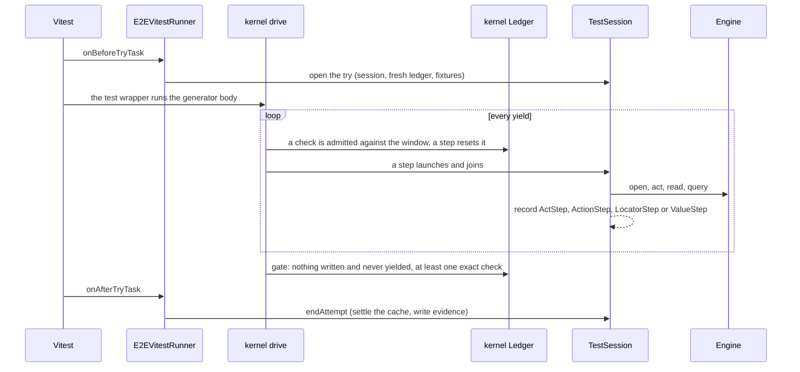
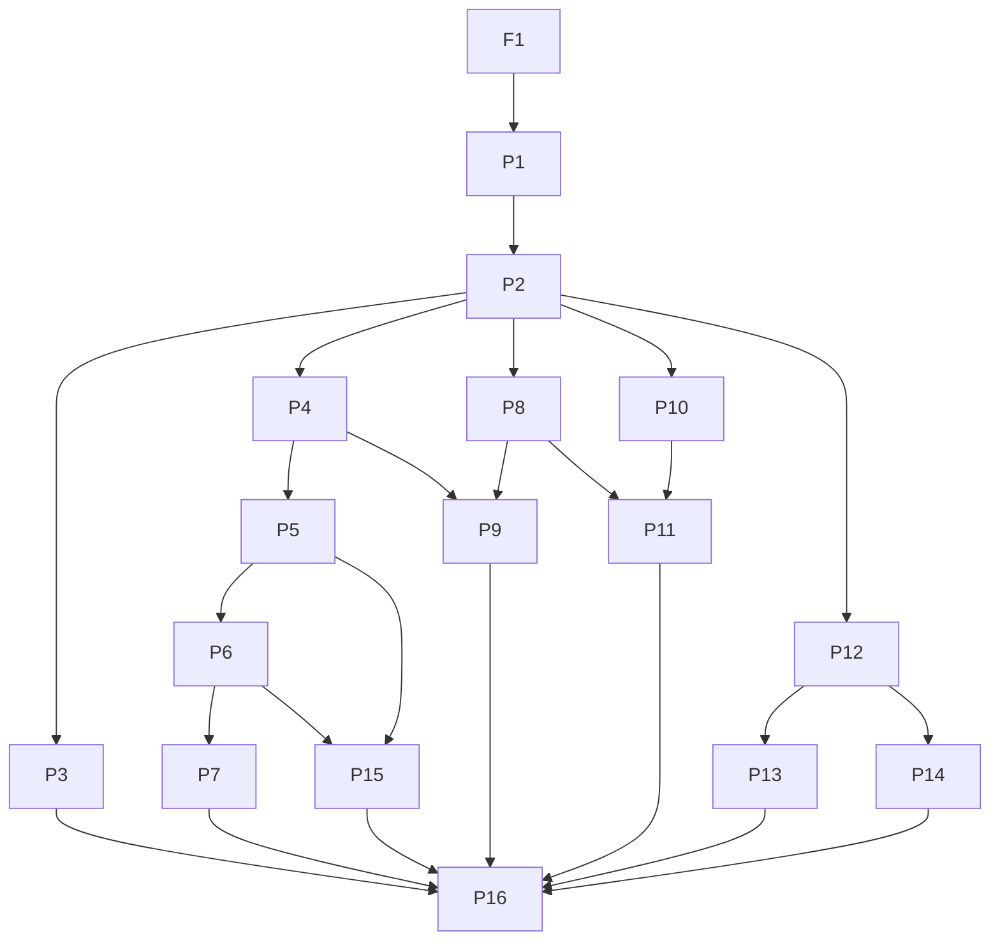

# effect-e2e meets the e2e bar and refuses slop tests through the compiler - Plan

## Goal Capsule

- **Objective:** A person writing web e2e tests with effect-e2e can do everything the `e2e` runner's skill teaches, and a slop e2e test does not compile.
- **Means:** One refusal kernel, owned by `@systemfsoftware/vitest` and consumed here, drives generator test bodies whose checks reach the body only through the test's own callback (KTD1, KTD3).
- **Product authority:** Linear SYS-1259 (its "Done when" and "Owner-approved exceptions") and the owner rulings recorded there. The bar is the skill that `e2e` 0.23.0 ships: `skills/e2e/SKILL.md` and `references/{writing-tests,agent,running}.md`.
- **Active scope:** the web engine only. Mobile engines, explore and the MCP server are not active scope; SYS-1259 records them as later, separate work.
- **Execution profile:** seventeen PRs, one in `systemfsoftware/systemfsoftware` and sixteen here. Each ends in a green `pnpm check:local`, is reviewed by fresh reviewers, and merges through the merge queue. The maker opens each PR and ce-work builds them in the order under Sequencing.
- **Stop conditions:** stop and report when the fork's npm release needs operator approval, when the core pin bump brings a core change that breaks this repo, when an owner answer changes a requirement the next unit builds on, or when a unit's browser behaviour cannot be reached through Playwright.
- **Open blockers:** none. Four owner questions are named switches under Owner-answer switches and do not hold planning. Two steps are gated: the fork's npm release (an external release) and the dependency vetting for each new third-party package.

---

## Product Contract

### Summary

effect-e2e replaces its raw-Vitest authoring surface with a fork-shaped e2e API on the web engine. Tests are generator bodies whose steps and checks are yielded and driven by the runner. Every behaviour the bar teaches is available through it, and each slop shape is refused with a message that names the rewrite. A conformance profile shows each behaviour exists, and a differential suite shows it matches `e2e`.

### Problem Frame

An effect-e2e author cannot make an exact interaction from a test, and the matcher, fixture, session, registration and cache-mode surface is a fraction of what `e2e` teaches. `ScreenFixture` returns locator data with no actions, `AppFixture` has one method, and `ScreenExpectation` has eight matchers. Registration goes through raw Vitest, which the fork's guard refuses.

Nothing stops a slop test: ten checks on one screen, no check at all, or only a model judgment. Review is the only defence, and review misses them. The fork shows the alternative for unit tests: the compiler counts a test's checks and refuses the shape. e2e tests need the same discipline on top of full parity with the bar.

### Key Decisions

- **Fork-shaped generator authoring.** Bodies are generators and every step and check is yielded. Governs R1, R2, R3, R4, R5. (session-settled: user-directed — chosen over async bodies with runtime-first refusals, and over typestate goal pinning: async bodies cannot make the Goal's own slop shapes fail to compile, and pinning adds machinery the rulings do not ask for.)
- **A check is bound to its test through the body's callback; there is no importable `expect`.** This is how the compiler counts a test's checks and refuses raw ones. Governs R1, R8. (session-settled: user-directed — chosen over a module-level `expect` import: the import is surface syntax, not a taught behaviour, and it breaks the binding the fork's mechanism relies on.)
- **Web engine only.** Governs R11 through R26. (session-settled: user-directed — chosen over web plus mobile, and over every engine: SYS-1259 records mobile, explore and MCP as later, separate work.)
- **No further exceptions.** Every web behaviour the bar teaches is built here, including screenshot comparison, video, and alternative agent executors. Governs R11 through R26. (session-settled: user-directed — chosen over proposing those groups as exceptions: "if our library doesn't reach the bar somebody needs to fix it.")
- **Model judgments never satisfy the no-check gate.** The replay cache may still treat `agent.assert` and `agent.waitFor` as confirmation for recording; the two rules stay separate. Governs R3, R25. (session-settled: user-approved — the agent proposed this with the tradeoff shown; the owner assented.)
- **Hooks exist; tests get fresh fixtures, serial groups share one chain.** Shared-state slop is refused by a guard where the guard can see it. Governs R15. (session-settled: user-approved — chosen over refusing hooks as the fork does: the bar teaches hooks, and fresh fixtures remove what the fork refuses them for.)
- **e2e tests run once.** The fork's second run on a fresh build is not carried over; shared-state detection rests on R15 alone. Governs R16. (session-settled: user-approved — the owner ruled it; the lost leak check was shown as the accepted cost.)
- **Parity is proven, not claimed.** A bar-parity profile in the private conformance suite exercises each taught behaviour through the public API. Governs R27, R28. (session-settled: user-approved — the agent proposed the form; the owner assented.)
- **Behaviour is compared with `e2e`, not only shown to exist.** A differential suite runs the same journeys under `e2e` 0.23.0 and under effect-e2e and compares each verdict. Governs R31. (session-settled: user-directed — chosen over the parity profile alone: the profile shows a behaviour exists, not that it matches `e2e`, and SYS-1259 names "nothing shows that effect-e2e behaves as e2e does" as the gap.)

### Requirements

**Authoring model**

- R1. A test body is a generator that receives the test's own checks as a callback parameter; effect-e2e exports no `expect`, and a check taken from elsewhere is refused.
- R2. A synchronous body, an `async` body, and a body that returns an Effect each fail to compile at the body, and the message names the generator rewrite.
- R3. A test whose body yields no exact check fails to compile at the test name, and the message names the rewrite. Only exact screen, browser and value checks count; `agent.assert`, `agent.waitFor` and `agent.extract` never do.
- R4. A body can yield only e2e steps and checks. A sleep, a fixed delay or a polling loop has no yieldable form, and the refusal names `waitFor` or a matcher `timeout` as the rewrite.
- R5. Two checks on one observed state are refused, and the message names the single-check rewrite. An observed state ends at any step that can change the screen or the page.
- R6. A weak check is refused with its rewrite: at least the fork's boolean-actual, vacuous-match and missing-argument cases, plus the e2e-specific weak checks that planning enumerates against the bar's matcher list.
- R7. A check that is written and never yielded is refused, and the existing detection of unawaited steps stays.
- R8. A test registered through raw Vitest `test` or `it`, or a check from raw Vitest `expect`, is refused with the rewrite named.
- R9. Every refusal message names its rewrite. A shape is refused at compile time wherever types can see it; every other shape is refused at run time with the same text. A run-time refusal ends the try with `BODY_REFUSED` in the refused class: exit 2, never retried, and never absorbed by `test.fail` or a `skip`.
- R10. For each slop shape the Goal names (many checks, no check, a model judgment as the only check), a type-level test shows a failing `tsc` run at the slop code. If planning shows `tsc` cannot reach the several-checks shape, that is recorded as a proposed exception for owner approval in SYS-1259, never left as review or documentation.

**Registration and run rules**

- R11. `test` takes the options the bar teaches: `timeout`, `retries` (0 to 10), `tags`, `skip`, `fail`, `platforms`, `requires`, `session`, `agentContext`, `agent` (a name, or a list run once per agent), `trace` and `video` modes. `describe` takes the group-level subset the bar names. A serial group and its members follow the bar's option restrictions, and a nested serial group is a collection error.
- R12. `test.skip` works bare and conditionally from the body, before the first step, and the report records the reason. `test.fail` marks an expected failure that passes on a test failure or timeout and fails with `UNEXPECTED_PASS` on a pass. An infrastructure error, such as an engine failure, still fails the test, and so does a `BODY_REFUSED` refusal (R9).
- R13. `test.only` works locally and is refused in CI with `ONLY_IN_CI`.
- R14. A `describe` body is synchronous, and an `async` one is a `COLLECTION_ERROR`. Serial groups run their members in order on one worker and retry as a whole.
- R15. `beforeEach`, `afterEach`, `beforeAll` and `afterAll` exist with the bar's ordering, timeout and failure semantics, and every test outside a serial group receives fresh fixtures; a serial group's members share the group's fixture chain (R11). `beforeAll` and `afterAll` receive the `request` step but no page-carrying fixture. State shared between non-serial tests through a hook is refused by a guard.
- R16. An e2e test runs once. There is no second run on a fresh build; retries happen only as the bar's retry rules say.

**Fixtures, locators and checks**

- R17. `app` provides `baseUrl`, `open`, `back`, `restart`, `clearState`, `screenshot`, `startRecording` and `stopRecording`, with the bar's failure behaviour.
- R18. `screen` provides the bar's locator queries and options, strictness with `LOCATOR_AMBIGUOUS`, `filter`, `first`, `last`, `nth`, `or`, scoping, `visible`, scrolling to a locator, `tree` and `debug`.
- R19. A test can act exactly: `tap`, `doubleTap`, `secondaryTap`, `longPress`, `fill` (text or secret), `pressSequentially`, `clear`, `press`, `check`, `uncheck`, `selectOption`, `focus`, `hover`, `setInputFiles`, `dragTo`, `scrollIntoView`, `swipe`, and the coordinate forms. A test can read as the bar's reads do, including `count` and `waitFor({ state })`.
- R20. Checks cover the bar's locator, browser and value matcher tables, including `toHaveCount` and `toHaveURL`, list forms, `.not` with its hold rule, `soft`, `poll`, `toMatchSchema`, the asymmetric matchers, and the option flips. Screenshot comparison covers snapshot files, update mode, masking, automatic secure-field masking and per-target files.
- R21. The browser fixture provides navigation, page reads, raw locators, frame locators, `evaluate`, init scripts, routes with `fulfill`, `continue`, `fallback` and `abort`, `waitForResponse`, cookies, viewport, media emulation, dialogs, downloads, and raw keyboard and mouse.
- R22. `test.extend` adds fixtures whose code after `use()` runs after a failing test too; a fixture applies only to tests registered through its own `test`. Fixture and hook bodies yield the same steps and checks as a test body, including a `request` step bound to `app.baseUrl` for API seeding and cleanup.
- R23. Sign-in sessions work: a setup test saves a named session once, dependent tests declare it, setup runs when only a dependent test is selected, and the setup restrictions hold. Credentials and secrets are opaque handles, redacted from reports, step labels, and model input, and accepted only by `fill` and agent params.
- R24. The `platform` fixture is available in tests and hooks.

**Agent and cache**

- R25. The agent keeps `act`, `assert`, `waitFor` and `extract` with the bar's options, budgets, error codes, `unique()` params, `onBeforeAction` and `onAction` hooks, per-agent configuration, and the vision modes on judgments that exist today. Agent `tools` and the alternative executors (decision-model, coding-agent, custom `StepExecutor`) are available.
- R26. Strict-cache mode fails a step whose committed recording no longer replays with `REPLAY_STALE`, replays on retries, and never writes the cache. Outside strict mode a retry runs every agent step live; only strict mode replays on a retry. The cache modes and the record-after-confirmation rule stay as they are.

**Proof and cutover**

- R27. A bar-parity profile in the private conformance suite exercises each behaviour in R11 through R26 through the public API against the web engine, and a table maps each taught behaviour to its evidence.
- R28. The parity profile runs in CI's engine-suite lane, and `pnpm check:local` runs it at the local profile.
- R29. The current API is removed in the same change set that replaces it: scaffolds, CLI `init` templates, package READMEs and fixtures migrate, and no old-API path or compatibility layer remains.
- R30. The author-facing run rules of `references/running.md` that the web engine exercises (selection by file and line, tags, grep, last-failed and shard, the CI defaults, exit-code classes, trace pages, `report.json`) are available through the CLI and runner API.
- R31. A differential suite in the private conformance suite runs the same journeys under `e2e` 0.23.0 and under effect-e2e against the web engine, and compares each journey's verdict.

### Acceptance Examples

- AE1. **Covers R3.** Given a test that opens a page and runs `agent.act` with no exact check after it, `tsc` reports an error at the test name, and the message names yielding a check from the callback.
- AE2. **Covers R3, R25.** Given a test whose only check is `agent.assert('the dashboard loads')`, `tsc` reports the same no-check error, and the message says a model judgment does not count.
- AE3. **Covers R4.** Given a body that waits with `setTimeout` between steps, no yielded form compiles, and the message names `waitFor`.
- AE4. **Covers R5.** Given a test that checks a list's count, then its heading, then its status text on the same screen with no step between, the second check is refused and the message names the single-check rewrite.
- AE5. **Covers R1, R8.** Given a test that imports `expect` from `vitest` or registers with `it`, the run refuses the test and names the callback-parameter rewrite.
- AE6. **Covers R13.** Given `test.only` in a run with `CI` set, the run fails with `ONLY_IN_CI`; locally it runs the one test.
- AE7. **Covers R12.** Given a `test.fail` test whose body passes, the test fails with `UNEXPECTED_PASS`.
- AE8. **Covers R22.** Given an extended fixture that creates a record and deletes it after `use()`, the delete runs when the test body fails.
- AE9. **Covers R26.** Given committed recordings and strict-cache mode, a step whose recording no longer replays fails with `REPLAY_STALE` and the run writes no cache entry.
- AE10. **Covers R16.** Given a passing e2e test, the runner executes the body once.
- AE11. **Covers R31.** Given a journey whose verdict differs between `e2e` and effect-e2e, the differential run fails and names the journey and the field that differs.

### Success Criteria

- Each behaviour the three bar files teach has a row in the R27 table that names the public API and the test that proves it.
- Each Goal slop shape fails `tsc` at the slop code with a message that names its rewrite, and a type-level test pins that.
- Each taught behaviour that a journey can exercise has a journey in the differential suite, and every journey's verdict matches `e2e`.
- `pnpm check:local` passes on each PR's head, and each PR merges through the merge queue.
- A reader of the compound `e2e-testing` pack can write its examples against this API without leaving the bar's taught behaviours.

### Scope Boundaries

**Deferred for later (SYS-1259 records these as owner-approved)**

- Mobile engines (iOS and Android), explore runs, and the MCP server.

**Outside this work**

- Moving any test to another runner, or writing a test around a gap.
- A compatibility layer or migration shim for the current API; the younna consumer has zero specs.
- The fork's second run on a fresh build.
- Editing graders, lints, typecheck or workflows to get green.
- A check that reads the bar's vocabulary and gates the R27 table. A new gate needs operator sign-off before it is proposed, and a table-completeness check is circular; independent review judges the table.

### Dependencies / Assumptions

- The compound `e2e-testing` pack (systemfsoftware PR #919) writes its examples in this API, so its examples follow this plan.
- The fork's refusal kernel (`packages/runner/vitest` in systemfsoftware) is the one refusal mechanism: the fork owns it and effect-e2e consumes it. Exposing it is a separate PR in that repository, followed by a fork release and a core pin bump here before the first effect-e2e change.
- The web engine sits on Playwright (`packages/effect-e2e-web`), so browser behaviours in R20 and R21 delegate to it where it already provides them. [Assumption: the engine SPI can carry the new actions and reads without a mobile engine in view.]
- Core packages come from the pinned `core` input and `.sfs-deps` tarballs. The fork change and the pin bump are the only core changes this work makes.
- `e2e` 0.23.0 and `@e2e-dev/web` are private dev dependencies of the conformance suite, for R31.

### Outstanding Questions

**Resolve Before Planning**

- None.

**Deferred to Implementation**

- How a serial group executes under Vitest 5 and reports one result per member (U14).
- Which differential journeys involve agent steps, and how each runner's scripted model stub answers them (U5, U19).
- The Playwright route each browser behaviour in R21 takes where Playwright offers more than one (U12, U13).

**Owner questions (raised in the report; none holds planning; each is a named switch under Owner-answer switches)**

- The bar's own example file checks a list count, a status text, and the URL after one goal. R5 refuses that shape as written. The plan assumes the taught behaviour is the matchers and that a single check can carry several facts about one state; confirm that this reading holds.
- Confirm that a run-time refusal is acceptable for any slop shape `tsc` provably cannot reach, now that the plan names each such shape and why, or whether each needs its own recorded exception.
- The bar teaches `expect.soft` (a failure is kept and the body runs on) and `expect.poll`. The fork refuses both as slop shapes, so under the fork's binding neither is reachable as taught. R20 keeps both; confirm whether they are carried in their taught form, as a check kind the ledger counts once, or whether each needs a recorded exception.
- The bar's value-matcher table lists `toBeTruthy`, `toBeFalsy`, `toBeDefined`, `toHaveLength` and `toHaveProperty`, and the fork refuses all five as weak. R6 refuses weak checks and R20 covers the bar's table; confirm whether the five stay available or are refused.

---

## Planning Contract

**Product Contract preservation:** changed — R31, AE11, one Key Decision and one Success Criterion added at the owner's direction; the Means line, the Hooks Key Decision, the Summary's parity sentence and the Dependencies fork bullet reworded; the Goal Capsule gained the execution-profile and stop-condition bullets; Scope Boundaries gained one non-goal and Dependencies one dev-dependency bullet; the planning-deferred Outstanding Questions are resolved in the units below and removed; the fourth owner question added. The doc-review revision extended R9, R12, R15, R20, R22 and R26 in place (refusal class, refusal absorption, serial sharing, secure-field masking, fixture and hook bodies, the cache-retry rule); R1 through R30 and AE1 through AE10 are otherwise unchanged.

### Key Technical Decisions

- KTD1. **The fork owns one refusal kernel and effect-e2e consumes it.** The fork exports the kernel (ledger, check brand, generator driver, refusal vocabulary, guard) on a new `kernel` subpath; effect-e2e adds `@systemfsoftware/vitest` as a runtime dependency and ships no second copy. A fork release and a core pin bump precede the first effect-e2e PR. Governs R1, R5, R6, R7, R8, R9. (session-settled: user-directed — chosen over a ported copy of the kernel in this repo: a second copy of the mechanism that refuses slop drifts from the original.)
- KTD2. **The kernel takes its vocabulary as data.** Refusal tables, the observed-state reset predicate and custom `expect` subjects are parameters of the kernel, and the fork's own `it` lanes pass the fork's defaults. effect-e2e states its own weak-check table and its own locator subject, so an owner answer to a matcher question is a table row, not a fork change. Governs R5, R6, R20.
- KTD3. **Steps are branded handles that launch when yielded, and fixtures expose no Promise.** A body's `yield*` operand is a branded step or check handle, never a bare Effect, so the generator's yield union cannot collapse to the widest `Effect` and a yielded `Effect.sleep` is a type error at the yield. The session's `launch`-and-`join` stays underneath: a body cannot fork a step (an `Effect.fork` result is not a yieldable handle), so `STEP_NOT_AWAITED` guards internal launches, and the ledger refuses a handle that is written and never yielded. Wait-class steps (`locator.waitFor`, `browser.waitForURL`, `waitForResponse`, `onDialog`, `waitForDownload`) arm before their trigger and join later, and an armed wait never joined is refused when the try ends. Hook bodies are generators too and receive fixtures without `expect`. Governs R1, R4, R7, R15.
- KTD4. **A step declares whether it changes the observed state.** Opening a page, every exact action, navigation, agent `act`, agent `waitFor`, `locator.waitFor` and `browser.waitForURL` reset the window; reads, the `request` step, `agent.assert` and `agent.extract` do not. The waits are steps, not checks: they never satisfy the R3 no-check gate, so a body of `agent.act` followed only by `browser.waitForURL` fails that gate. The kernel's reset predicate reads that declaration. Governs R3, R5.
- KTD5. **Each slop shape is refused where the compiler can see it, with the compiler's reach recorded per shape.** The decision matrix under High-Level Technical Design is the record; shapes `tsc` cannot reach are the proposed exception request under its own heading. Governs R2, R3, R4, R5, R7, R8, R9, R10, R15.
- KTD6. **Exact checks record a step, and only locator checks confirm the cache.** Locator checks record `LocatorStep`, value checks record `ValueStep`, and `locator.waitFor` and `browser.waitForURL` record `LocatorStep`. `VERIFICATION_TAGS` in `src/cache/settle-recordings.workflow.ts` is unchanged, so a value check never confirms a recording, as the bar says. Today nothing in `src/runner` produces either record, so an `act` followed by a locator check cannot confirm a recording. Governs R3, R20, R26.
- KTD7. **The engine SPI grows by extending its tagged unions and capability literals, and no engine operation ships without a law.** `Action`, `ReadRequest`, `LocatorExpression` and `EngineCapability` gain members; the web engine delegates to Playwright; `memoryEngine` and `engine-law.ts` grow in the same PR. Governs R17, R18, R19, R21, R23.
- KTD8. **Exact actions record an `ActionStep`.** A new `StepRecord` tag lets the trace page and `report.json` show what a test did exactly. Exact actions are not cached. Governs R19.
- KTD9. **Strict mode is a cache option, and `--strict-cache` takes the bar's meaning.** `cache.strict` in the config and the `--strict-cache` flag turn a handed-off replay into `REPLAY_STALE`, let retries replay, and write nothing. The flag's current meaning (read-only) is removed. Governs R26. (session-settled: user-approved — chosen over keeping the read-only meaning beside a new flag: zero consumers, so no old meaning is kept.)
- KTD10. **The browser fixture and `test` typed with it ship from `@systemfsoftware/effect-e2e-web`.** The core `test` is generic over fixtures; the web package supplies the browser-typed `test`, `describe` and hooks, as the bar's `@e2e-dev/web` does. A portable suite declares `requires: ['browser']`. Governs R21.
- KTD11. **Sessions, credentials and secrets reach a body as fixtures.** `session`, `credentials` and `secrets` are callback-bound like `expect`, so no ambient module state carries a handle. The import location is surface syntax, not a taught behaviour. Governs R23.
- KTD12. **The differential harness compares paired journeys through each runner's report.** Each journey has an `e2e` source and an effect-e2e source against one site, runs under `e2e run --reporter json` and `effect-e2e run`, and is compared on status, failure code and exit code, after U18 aligns effect-e2e's verdict statuses and exit-code rule with the bar's. `E2E_TELEMETRY_DISABLED=1` and `DO_NOT_TRACK=1` are set in the spawned environment. Governs R31. (session-settled: user-directed — inherits the label of the Key Decision on differential comparison.)
- KTD13. **The decision-model and coding-agent executors are separate packages over a core `StepExecutor` seam.** `@systemfsoftware/effect-e2e-decision` and `@systemfsoftware/effect-e2e-acp` mirror the bar's `@e2e-dev/decision` and `@e2e-dev/acp`, so core keeps its two dependencies and each package's third-party dependencies pass the vetting rule in its PR body. Governs R25.
- KTD14. **The cutover is atomic.** U3 and U4 land in one PR that removes the raw-Vitest `test` and hybrid `expect` and migrates every caller, so no old-API path exists on `main` at any commit. Governs R29.

### High-Level Technical Design

Component and lifecycle of one try. The kernel is the fork's; everything else is here.



Decision matrix: where each slop shape is refused. "Compiler's own" means `tsc` refuses the code with TypeScript's message, which cannot name the rewrite.

| Shape | Requirement | `tsc`, our message | `tsc`, compiler's own | Run time only | Mechanism |
|---|---|---|---|---|---|
| Sync, `async` or Effect-returning body | R2 | yes | | backstop | `BodyRefusal` parameter union on `test` |
| No exact check in the body | R3 | yes, at the test name | | backstop | Gate on yielded requirements |
| Model judgment as the only check | R3 | yes, at the test name | | backstop | Judgments carry no `Asserted` requirement |
| An Effect that is not an e2e step (`Effect.sleep`, a delay, a loop) yielded | R4 | | yes, at the yield | backstop | Branded step and check handles; an Effect is not a `yield*` operand, and the run-time brand gate names the rewrite |
| `yield*` of a bare Promise, or `await` inside the generator | R4 | | yes | | A Promise is not iterable; `await` needs `async` |
| Weak matcher (boolean actual, vacuous match, missing argument, vacuous e2e shapes) | R6 | yes, at the call | | backstop | Refusal members typed with `this` |
| `async` `describe` body | R14 | yes | | `COLLECTION_ERROR` | Return-type conditional on the `describe` parameter |
| Several checks on one observed state | R5 | | | yes | Kernel ledger window; a generator's yields are an unordered union |
| A check or step written and never yielded | R7 | | | yes | Kernel ledger `written` against `yielded` |
| Raw Vitest `test`, `it` or `expect` | R8 | | | yes | Kernel guard in `E2EVitestRunner` |
| State shared through a closure variable written in a hook | R15 | | | not detectable | Fresh fixtures and typed hooks cover what is visible |

Authoring surface. Directional; the units own the signatures.

```ts
test('adds a todo', function* ({ app, agent, screen, expect }) {
  yield* app.open('/todos')                          // step: resets the window
  yield* agent.act('add a todo named {title}', { params: { title } })   // step
  yield* expect(screen.getByRole('status', 'Remaining')).toHaveText('1 remaining') // check: counts once
  yield* screen.getByRole('button', 'Add').tap()     // exact step
})
// refused at the test name: a body yielding no exact check, only agent.assert, or Effect.sleep
```

### Owner-answer switches

Each question is carried as built-as-written. The table says what an answer would change; nothing here is settled.

| Question | Built until answered | An answer would change | Units touched |
|---|---|---|---|
| 1. The bar's multi-check example against R5 | R5 as written: one check per observed state; the bar's example file is transcribed as several tests | If a check may carry several facts: add a composite state check to R20 and a unit after U9; AE4 and R5 stand. If several checks per state are allowed: R5, AE4 and the R10 exception request change, and the kernel's window option is set to unbounded for locator checks | U1 option, U3, U9; R5, R10, AE4 |
| 2. `expect.soft` and `expect.poll` | Both are check kinds the ledger counts once, so R5 applies to them (U11 as written) | "Taught form": several soft checks on one state are allowed and kept, so soft checks stop counting against the window and U11 and R5's application to soft change. "Exception": delete U11 and drop both from R20. A different counting rule: one rule in U11 | U11; R5, R20, R10 |
| 3. Run-time refusal for shapes `tsc` cannot reach | Every shape in the decision matrix is built as shown, and the exception request lists each non-compile shape with its reason | "Run time acceptable": the request collapses to one approval. "Each needs an exception": each request row is posted to SYS-1259 | none in code; R9, R10 |
| 4. The five bar-listed weak value matchers | They stay available, R20 as written | "Refuse": add five rows to the e2e refusal table in U10 and invert their parity rows | U10; R6, R20 |

### Proposed exception for SYS-1259 (R10)

`tsc` cannot reach these shapes under generator authoring. Each row is a request for owner approval in SYS-1259; the maker does not record an exception as approved.

| Shape | Requirement | Why `tsc` cannot reach it | What refuses it instead |
|---|---|---|---|
| Several checks on one observed state | R5, R10 | A generator's yield type is the union of what it yields, with no order, so the number of checks between two steps is not a type. The fork refuses it at run time for the same reason. | The kernel ledger refuses the second check with the single-check rewrite, before the test continues. |
| A bare-Promise sleep (`yield*` of a Promise, `await` in the generator) | R4 | The compiler refuses the code, but with TypeScript's own message about iterators or `async`, which cannot name `waitFor`. | The compiler's refusal. A Promise yielded with `yield` is refused at the test name with our message. |
| An Effect that is not an e2e step (`Effect.sleep`, a delay, a loop) yielded | R4 | The branded handle union rejects it at the yield with the compiler's own assignability message, which cannot name `waitFor` (KTD3). | The compiler's error at the yield; the run-time brand gate refuses it with the rewrite. |
| State shared through a closure variable written in a hook | R15 | A closure write is invisible to types, and run-time detection needs the second run on a fresh build that the owner removed. | Typed hooks (no value channel; `beforeAll` and `afterAll` receive only the `request` step) and fresh fixtures per test outside serial groups, which refuse the visible forms. |
| A check or step written and never yielded | R7 | A discarded value is not a type error in TypeScript. U1 verifies the fork's language-service diagnostic for unyielded checks; if it covers authored bodies, this row moves to compile time and leaves the request. | The kernel ledger refuses it when the body returns. |
| Raw Vitest `test`, `it` or `expect` | R8 | Another package's exports are outside this package's types. | The kernel guard refuses the test or the call. |

### Alternatives Considered

- **Port the kernel into this repo.** Rejected by the owner: a second copy drifts from the fork (KTD1).
- **Register tests through the fork's `it` lane.** The lane builds a virtual `TestClock` and `TestConsole` into every body and runs a second pass on a fresh build when `rerunnable` is set (`packages/runner/vitest/src/internal/runner.ts`). Real-time e2e bodies need neither, and R16 removes the second run, so the kernel is extracted instead.
- **A general-purpose Playwright passthrough for the browser fixture.** Rejected: it would give an author an unrecorded, unredacted route around R21's steps, and `evaluate` already covers the page-side cases.

### Verified prerequisites and assumptions

- `LocatorStep` and `ValueStep` exist in `src/verdict/step-record.schema.ts` and `src/run/trace.ts`, and `VERIFICATION_TAGS` lists `LocatorStep`; nothing in `src/runner` or `src/run/test-session.service.ts` records either (grep over `src`).
- `REPLAY_STALE` is a declared failure code with no producer, and `--strict-cache` maps to `read-only` (`packages/effect-e2e-cli/src/run/flags.ts`, `cacheValueOf`).
- The engine's `Action` union already has `Tap`, `Fill`, `Type`, `Press`, `Select`, `Check`, `Hover`, `Drag`, `Swipe`, `SwipePath`, `TapAt`, `TypeAt`, `Screenshot` and `WaitFor`; `EngineShape.route` is the page route, not request interception.
- `unique()` exists in `src/cache/key.schema.ts` and `onAction` exists on `act`; `onBeforeAction`, agent `tools`, an executor seam and agents other than `default` do not.
- `@systemfsoftware/vitest` is a dev dependency at 3.0.0 through `.sfs-deps`; npm's latest is 2.0.0 and the fork's head is 4.0.1, so a fork release and pin bump are real work.
- CI runs the static lane and the affected tests on a pull request and on a merge-queue draft; `main` runs every package's whole suite and the browser engine suites (`test:engine`) (`.github/ci/pr-tests.mjs`, repo `AGENTS.md`). Changed engine tests run on a PR through the affected lane; unchanged browser surfaces are proven on `main`, so engine-bound proof is pending off-host until then.
- `e2e` 0.23.0 is Apache-2.0, needs Node `^22.22.3 || >=24.8.0`, and `@e2e-dev/web` 0.15.5 pins `playwright-core` 1.64.1 against this repo's `playwright ^1.64.0`.
- [Unverified] Vitest 5 retries per test, not per suite, so a serial group likely registers as one task; U14 verifies this first.

### Sequencing and PRs

| PR | Repo | Title | Units | Requirements | Depends on |
|---|---|---|---|---|---|
| F1 | systemfsoftware | `feat(vitest): export the check kernel` | U1 | R1, R5, R6, R8, R9 | none; then the fork release |
| P1 | effect-e2e | `chore(deps): take core with the vitest check kernel` | U2 | | F1, release |
| P2 | effect-e2e | `feat(runner)!: generator test bodies on the check kernel` | U3, U4 | R1–R10, R14, R15, R16, R24, R29 | P1 |
| P3 | effect-e2e | `test(conformance): differential harness against e2e 0.23.0` | U5 | R31 | P2 |
| P4 | effect-e2e | `feat(runner): locator algebra, exact actions and reads` | U6, U7, U8 | R18, R19 | P2 |
| P5 | effect-e2e | `feat(runner): the full check surface` | U9, U10, U11 | R5, R6, R20 | P4 |
| P6 | effect-e2e | `feat(web): browser fixture, pages and state` | U12 | R17, R20, R21 | P5 |
| P7 | effect-e2e | `feat(web): browser fixture, network, dialogs and downloads` | U13 | R21 | P6 |
| P8 | effect-e2e | `feat(runner): registration options and run rules` | U14 | R11–R14 | P2 |
| P9 | effect-e2e | `feat(runner): extended fixtures and sign-in sessions` | U15, U16 | R22, R23 | P8, P4 |
| P10 | effect-e2e | `feat(cache): strict-cache mode` | U17 | R26 | P2 |
| P11 | effect-e2e | `feat(cli): selection by line, tag mode, grep and shard` | U18 | R30 | P8, P10 |
| P12 | effect-e2e | `feat(agent): per-agent tests, tools, hooks and the executor seam` | U19 | R25 | P2 |
| P13 | effect-e2e | `feat(decision): decision-model executor package` | U20 | R25 | P12 |
| P14 | effect-e2e | `feat(acp): coding-agent executor package` | U21 | R25 | P12 |
| P15 | effect-e2e | `feat(web): screenshot comparison, recording and video` | U22 | R6, R11, R17, R20 | P5, P6 |
| P16 | effect-e2e | `docs(conformance): bar coverage table and close-out` | U23 | R27, R28, R29 | all |



Dependent PRs open against `main` after their dependency merges. Where a stack avoids idle time, use Mergify's supported stack and its sync behaviour, never a manual collapse. Each PR advances every changed publishable package by at least a patch and adds a changeset; P2 advances the core and CLI packages by a major, and P13 and P14 publish their packages at 0.1.0. F1 stays one PR by default; if U1's sizing shows the typed-table refactor cannot land atomically, F1 splits into the kernel export and a second fork PR for the typed tables, and P1 takes both before P2 starts — the refusal mechanism stays the fork's one mechanism either way.

---

## Implementation Units

| U-ID | Title | Files touched | Depends on |
|---|---|---|---|
| U1 | Fork kernel export | `packages/runner/vitest/src/kernel.ts`, `internal/*` | none |
| U2 | Core pin bump | `flake.nix`, `flake.lock`, `pnpm-workspace.yaml` | U1 |
| U3 | Authoring surface on the kernel | `src/runner/test-api.ts`, `fixtures.ts`, `vitest-runner.ts` | U2 |
| U4 | Cutover and slop compile tests | conformance fixtures, CLI templates, READMEs | U3 |
| U5 | Differential harness | `packages/effect-e2e-conformance/tests/differential*` | U4 |
| U6 | Locator algebra | `src/engine/locator.schema.ts`, web `locator.ts` | U4 |
| U7 | Exact actions | `src/engine/action.schema.ts`, web `actions.ts` | U6 |
| U8 | Reads and waits | `src/engine/engine.schema.ts`, web `reads.ts` | U6 |
| U9 | Locator matchers | `src/runner/screen-expectation.ts` | U7, U8 |
| U10 | Value matchers and weak-check table | `src/runner/check-table.ts` | U9 |
| U11 | `soft` and `poll` | `src/runner/soft-poll.ts` | U10 |
| U12 | Browser fixture, pages and state | `packages/effect-e2e-web/src/browser.ts` | U11 |
| U13 | Browser fixture, network and dialogs | `packages/effect-e2e-web/src/network.ts` | U12 |
| U14 | Registration options and run rules | `src/runner/options.ts`, `vitest-runner.ts` | U4 |
| U15 | Extended fixtures | `src/runner/extend.ts` | U14 |
| U16 | Sessions, credentials, secrets | `src/runner/session-fixtures.ts` | U15, U8 |
| U17 | Strict cache | `src/cache/classify-replay.workflow.ts`, CLI `flags.ts` | U4 |
| U18 | CLI selection and `list` | `packages/effect-e2e-cli/src/run/*` | U14, U17 |
| U19 | Agent surface completion | `src/agent/*`, `src/Config/config.schema.ts` | U4 |
| U20 | Decision-model executor package | `packages/effect-e2e-decision/` | U19 |
| U21 | Coding-agent executor package | `packages/effect-e2e-acp/` | U19 |
| U22 | Screenshots, recording and video | `src/runner/screenshot.ts`, web `recording.ts` | U11, U12 |
| U23 | Coverage table and close-out | conformance README, package READMEs | all |

### Phase: the kernel and the cutover (F1, P1, P2)

### U1. Fork kernel export

**Target repo:** `systemfsoftware/systemfsoftware`; paths below are repo-relative to it, in a `wt` worktree there, under that repository's own `AGENTS.md`.

**Goal:** `@systemfsoftware/vitest` exposes its refusal kernel on a `kernel` subpath so another library mints checks, drives generator bodies and refuses slop with the fork's own mechanism.

**Requirements:** R1, R5, R6, R8, R9; KTD1, KTD2.

**Dependencies:** none.

**Files:**
- `packages/runner/vitest/src/kernel.ts` (new public entry)
- `packages/runner/vitest/src/internal/checks.ts`, `internal/refusals.ts`, `internal/driver.ts`, `internal/guard.ts`, `internal/runner.ts`
- `packages/runner/vitest/package.json`, `tsdown.config.ts`, `README.md`
- Test: `packages/runner/vitest/tests/kernel.runner.test.ts`, `packages/runner/vitest/test-types/kernel.tst.ts`

**Approach:**
1. Size the refusal-table refactor against fork head first: the shipped 3.0.0 dist declarations key `Positive`, `Negative`, `Refused` and `Needed` on module-level constants, so threading consumer tables through `expectFor` and merging the `expect(actual)` overloads may not fit one PR. If the sizing says it cannot land atomically, F1 splits into the kernel export and a second fork PR for the typed tables; P1 takes both before P2 starts.
2. Export from `kernel.ts`: `Asserted`, `Check`, `Ledger` with `makeLedger`, a check minter and `isCheck`, `drive`, `expectFor`, the types `Gate`, `RequirementOf`, `Body`, `BodyRefusal`, the refusal texts and their `this`-typed forms, and `installGuard`, `markTask`, `isMarked`.
3. Turn the refusal tables (`refusedText`, `negatedText`, `neededText`) into parameters of `expectFor`; the fork's own lanes pass the current tables, so `it` behaviour does not change.
4. Type the driver so steps and checks yield branded, non-Effect handles from their iterator, so a generator's yield union cannot collapse to the widest `Effect` (KTD3); `yield*` of `Effect.sleep` is a type error at the yield.
5. Give `drive` a reset predicate; its default resets on every non-check yield, as today. Give the window an optional per-window check limit beside it, `unbounded` allowed and one as the default, so owner question 1 can be answered without a second fork release.
6. Give `expectFor` an ordered list of subjects (`matches(actual)`, `checks(actual, mint)`), typed so `expect(actual)` overloads merge.
7. Leave `soft` and `poll` refused by default; a consumer table may replace them.
8. Check whether the fork refuses an unyielded check at build time through its language-service diagnostic; if it does, export that check with the kernel so R7's exception row moves to compile time.
9. Bump the fork's version (additive, minor) and add its changeset. The npm release is an external release and needs operator approval.

**Execution note:** The fork's existing refusal suites (`tests/refusal.runner.test.ts`, `test-types/refusals.tst.ts`) are the regression guard; keep them green through the refactor. The sizing in step 1 reads fork head, not the 3.0.0 tarball.

**Patterns to follow:** the fork's `Checks`, `Ledger` and `drive` as they stand; its `@since` documentation style.

**Test scenarios:**
- A consumer subject mints a check, and the ledger counts it once in its window.
- A consumer table that omits `toBeTruthy` accepts it, while the fork's default table still refuses it with the original text.
- A reset predicate that returns false for a read keeps one window across the read; a second check in it is refused.
- Two subjects that both match: the first listed wins.
- A window limit of 2 admits two checks in one window and refuses the third; `unbounded` admits them all.
- A consumer check yielded inside a forked fiber still reaches the ledger.
- `kernel` types compile for a consumer with no layer services: a body yielding one consumer check has no refusal at its name, and a body yielding none has the no-check refusal.
- The fork's own `it` lanes pass their existing suites unchanged.

**Verification:** the fork's gates pass; a consumer fixture imports `@systemfsoftware/vitest/kernel` from a built tarball and registers one check.

### U2. Core pin bump

**Goal:** this repo resolves the fork release that carries the kernel.

**Requirements:** KTD1.

**Dependencies:** U1 and the fork release.

**Files:**
- `flake.nix`, `flake.lock`, `pnpm-workspace.yaml`, `pnpm-lock.yaml`
- `packages/effect-e2e/package.json`, `packages/effect-e2e-conformance/package.json`

**Approach:**
1. Bump the `core` input to a full commit that carries the release; rebuild `.sfs-deps`; update every moved override version; run `pnpm install`.
2. Move `@systemfsoftware/vitest` into core's `dependencies`; keep the dev dependency elsewhere.
3. Stop and report if any other core package that moved breaks a build or a test.

**Test expectation:** none -- dependency pin only; the proof is a green `pnpm check:local` with no source change.

**Verification:** `pnpm check:local` passes and `pnpm why @systemfsoftware/vitest` names one version.

### U3. Authoring surface on the kernel

**Goal:** `test`, `describe` and the hooks take generator bodies that the kernel drives, with `expect` and the fixtures arriving through the callback.

**Requirements:** R1, R2, R3, R4, R5, R6, R7, R8, R9, R14, R15, R16, R24; KTD1, KTD3, KTD4, KTD5, KTD6.

**Dependencies:** U2.

**Files:**
- `packages/effect-e2e/src/runner/test-api.ts` (rewritten), `fixtures.ts`, `screen-expectation.ts`, `vitest-runner.ts`, `mod.ts`
- `packages/effect-e2e/src/run/test-session.service.ts`
- `packages/effect-e2e/src/runner/refusals.ts` (e2e rewrite texts), `src/verdict/failure.schema.ts`, `src/verdict/failure-class.schema.ts` (`HOOK_FAILED`, `BODY_REFUSED`)
- Test: `packages/effect-e2e/tests/authoring.integration.test.ts`, `packages/effect-e2e/test-types/authoring.tst.ts`

**Approach:**
1. Register each test with Vitest through a marked wrapper that builds the try's ledger and drives the generator inside the try's fiber, with the session's services provided.
2. Rebuild the fixtures as Effects over the session: `app.open`, the four `agent` calls, `screen` locator builders, `platform`, and `expect` from `expectFor` with the locator subject.
3. Rewrite the eight existing matchers as locator checks that poll within `assertionTimeout` and record a `LocatorStep`; value checks record a `ValueStep` (KTD6).
4. Declare which steps reset the window (KTD4): `open`, `act`, `waitFor`, `locator.waitFor` and `waitForURL` do; reads, `request`, `assert` and `extract` do not.
5. Give hooks generator bodies with fixtures and no `expect`, outer-first for `beforeEach` and inner-first for `afterEach`; a failing `beforeAll` is a `HOOK_FAILED` run error that skips its scope.
6. Install the kernel guard in the `E2EVitestRunner` constructor and refuse unmarked tasks in `onBeforeRunTask`, with the effect-e2e rewrite text.
7. Give `describe` a parameter whose return type refuses a Promise, so an `async` body fails at compile time.
8. Run each body once; add no second-run lane.
9. A run-time refusal — the no-check gate, a second check in a window, a written-never-yielded handle, an armed wait never joined — ends the try with `BODY_REFUSED` (R9): exit 2, not retried, not absorbed by `test.fail`.

**Patterns to follow:** `src/run/admit-evidence.workflow.ts` for any pure decision; the existing `launched` and `join` in `test-session.service.ts`.

**Test scenarios:**
- A test that opens a page and passes a locator check passes, and the report holds a passed `LocatorStep`.
- A failing check stops the test; the step after it never starts, and the generator's `finally` runs.
- Two checks in one window: the second is refused with the single-check text (AE4); with a step between them both pass.
- A locator check written and not yielded is refused when the body returns; a step written and not yielded is refused the same way.
- A body that yields no check fails the no-check backstop at run time with the compile-time text.
- A test registered through raw Vitest `test` is refused naming effect-e2e's `test`; a raw `expect` call inside an effect-e2e test is refused naming the callback parameter (AE5).
- An `act` followed by a locator check leaves a saved cache entry; an `act` followed only by a value check leaves it unconfirmed (KTD6).
- A body runs exactly once on a pass, and once per retry on a failure (AE10).
- A retried test starts with an empty ledger window.
- A run-time refusal reports `BODY_REFUSED`, is not retried, and a `test.fail` body that draws it still fails.
- Fixtures are new objects per test outside serial groups: state set on one in test A is absent in test B; two members of a serial group see the same fixture objects.
- `beforeEach` runs outer-first and `afterEach` inner-first; a failing `beforeAll` skips its scope with `HOOK_FAILED`.
- `platform` is readable in a test and in each hook.

**Verification:** the authoring suite passes against the memory engine, and `pnpm --filter @systemfsoftware/effect-e2e test:types` passes.

### U4. Cutover and slop compile tests

**Goal:** no caller uses the old API, and each Goal slop shape fails `tsc` with a message that names its rewrite.

**Requirements:** R10, R29; KTD5, KTD14.

**Dependencies:** U3.

**Files:**
- `packages/effect-e2e-conformance/tests/__fixtures__/runner-suite/tests/*.e2e.ts` (nine files), `runner-suite/*.ts`
- `packages/effect-e2e-conformance/tests/runner.integration.test.ts`, `cli-init*.integration.test.ts`
- `packages/effect-e2e-cli/src/templates/example.template.ts`, `example-agent.template.ts`
- `packages/effect-e2e/README.md`, `packages/effect-e2e-cli/README.md`, `README.md`
- `packages/effect-e2e/package.json`, `packages/effect-e2e-cli/package.json`, `.changeset/`
- Test: `packages/effect-e2e-conformance/tests/slop-refusal.integration.test.ts`, `packages/effect-e2e-conformance/tests/__fixtures__/slop/`, `packages/effect-e2e/test-types/authoring.tst.ts`

**Approach:**
1. Migrate every fixture suite file, the two `init` templates and the three READMEs to generator bodies and the callback `expect`.
2. Remove the raw-Vitest re-exports and the hybrid `expect` from `src/runner/mod.ts`; run the API extractor and update its reports.
3. Add a slop fixture project of small `.ts` files, one per shape, and a test that spawns the repo's `tsc` on it and reads the diagnostics.
4. Pin the same shapes in `authoring.tst.ts` with tstyche.
5. Advance core and CLI by a major, and add the changeset.

**Patterns to follow:** the fork's `test-types/refusals.tst.ts` for the tstyche shape; `tests/cli-init.integration.test.ts` for spawning.

**Test scenarios:**
- A well-formed test compiles with exit 0.
- No exact check, only `agent.assert`, a sync body, an `async` body, an Effect-returning body, a boolean-actual `expect`, and an `async` `describe` each make `tsc` exit non-zero, and each diagnostic contains its rewrite phrase.
- A `yield*` of a bare Promise and a yielded `Effect.sleep` each make `tsc` exit non-zero with the compiler's own message, recorded in the exception request.
- Control: two checks on one state compile, and the run refuses them (U3), which is the evidence behind the exception request.
- The `init` scaffold generated by the CLI type-checks.
- A grep of the repo for `from '@systemfsoftware/effect-e2e/runner'` imports of `expect` returns none.

**Verification:** `pnpm check:local` passes; the slop test names every shape in the decision matrix that is marked compile-time.

---

### Phase: proof (P3)

### U5. Differential harness

**Goal:** the same journeys run under `e2e` 0.23.0 and effect-e2e, and any verdict difference fails the run naming the journey and the field.

**Requirements:** R31; KTD12.

**Dependencies:** U4.

**Files:**
- `packages/effect-e2e-conformance/package.json` (dev dependencies `e2e` 0.23.0 and `@e2e-dev/web` 0.15.5, exact), `pnpm-lock.yaml`
- `packages/effect-e2e-conformance/src/compare-verdicts.workflow.ts`
- `packages/effect-e2e-conformance/tests/differential.integration.test.ts`, `packages/effect-e2e-conformance/vitest.config.ts` (add to `BROWSER_TESTS`)
- `packages/effect-e2e-conformance/tests/__fixtures__/differential/` (journey table, `e2e` config, paired suites, reuse of the heading and law sites)
- Test: `packages/effect-e2e-conformance/src/__tests__/compare-verdicts.workflow.property.test.ts`

**Approach:**
1. Define a journey as a name, an `e2e` source, an effect-e2e source and the site it opens.
2. Spawn `e2e run --reporter json` and `effect-e2e run` per suite with isolated output directories and `E2E_TELEMETRY_DISABLED=1` and `DO_NOT_TRACK=1`.
3. Compare each journey's status, failure code and exit code through a pure `compareVerdicts` workflow.
4. Start with journeys for opening and a heading check, a missing locator, an ambiguous locator, a wrong text, a skip and a retried failure; later PRs append journeys for their behaviours.
5. Check that `pnpm why playwright-core` resolves `1.64.1` beside the repo's `playwright`, so one Chromium revision serves both runners; pin if it does not.
6. Put the dependency vetting for `e2e` and `@e2e-dev/web` in the PR body: registry maintainers and publish provenance, download counts, source contributors, and real dependents.

**Execution note:** write the comparison workflow and its property test first; the browser journeys come after.

**Patterns to follow:** `src/run/admit-evidence.workflow.ts` and its property test; `tests/__fixtures__/cli-run.fixture.ts` for spawning.

**Test scenarios:**
- Equal reports yield no difference; changing any one compared field yields a difference that names that field.
- A deliberately divergent journey pair makes the differential run fail naming the journey and the field (AE11).
- A journey that fails identically under both runners passes the comparison.
- The spawned `e2e` process sends no telemetry request.

**Verification:** the workflow property test passes locally; the browser journeys are pending off-host in `pnpm check:ci`'s `test:engine` lane.

---

### Phase: locators, actions and checks (P4, P5)

### U6. Locator algebra

**Goal:** `screen` builds the bar's locators, and the engines resolve them strictly.

**Requirements:** R18; KTD7.

**Dependencies:** U4.

**Files:**
- `packages/effect-e2e/src/engine/locator.schema.ts`, `src/engine/memory-engine.ts`, `src/engine/memory-site.schema.ts`
- `packages/effect-e2e/src/runner/locator-fixture.ts` (new), `fixtures.ts`
- `packages/effect-e2e-web/src/locator.ts`
- `packages/effect-e2e-conformance/src/engine-law.ts`, `tests/__fixtures__/law-site.ts`
- Test: `packages/effect-e2e/src/schema-laws.test.ts`, `packages/effect-e2e-conformance/tests/port-fake/port-fake-law.integration.test.ts`

**Approach:**
1. Extend `LocatorExpression` with `Or`, `Has`, `HasNot`, a not-text filter, a display-value query, role state options (`checked`, `disabled`, `selected`, `expanded`, `pressed`, `level`), a `visible` flag and a pattern form for RegExp.
2. Map each to Playwright in `locator.ts`; implement the same in `memoryEngine`.
3. Build the chainable `LocatorFixture` over locator data: every query is also a method on a locator, scoped to its subtree, plus `filter`, `first`, `last`, `nth` and `or`.
4. Add a law per new expression; a locator that matches two nodes fails `LOCATOR_AMBIGUOUS` in every engine.

**Patterns to follow:** the existing `Filter`, `Nth` and `Frame` members and their recursion budget.

**Test scenarios:**
- `getByRole('button', 'Save')` misses `Save changes`; `exact: false` matches it case-insensitively.
- `or` of two locators that both match fails `LOCATOR_AMBIGUOUS` until `first()` narrows it.
- `filter({ hasNotText })` excludes a matching subtree; `filter({ has })` and `filter({ hasNot })` select by descendant.
- `visible: true` drops a hidden node before the exactly-one rule.
- `getByDisplayValue` finds an input by its current value.
- An empty `filter({})` is `INVALID_LOCATOR`.
- A scoped query resolves only inside its parent's subtree.

**Verification:** the fake and the web engine pass the same laws; the fake runs locally, the web engine off-host.

### U7. Exact actions

**Goal:** a test performs every exact interaction the bar lists, and each one is recorded.

**Requirements:** R19; KTD4, KTD7, KTD8.

**Dependencies:** U6.

**Files:**
- `packages/effect-e2e/src/engine/action.schema.ts`, `memory-engine.ts`
- `packages/effect-e2e/src/verdict/step-record.schema.ts`, `src/run/trace.ts`, `src/report/report.schema.ts`, `src/report/json-schema.ts`
- `packages/effect-e2e/src/run/test-session.service.ts`, `src/runner/locator-fixture.ts`
- `packages/effect-e2e-web/src/actions.ts`
- `packages/effect-e2e/src/verdict/failure.schema.ts` (`INVALID_ARGUMENT`)
- Test: `packages/effect-e2e/tests/exact-actions.integration.test.ts`, `packages/effect-e2e-conformance/src/engine-law.ts`

**Approach:**
1. Add `DoubleTap`, `SecondaryTap`, `LongPress`, `Clear`, `Focus`, `SetInputFiles`, `ScrollIntoView` and `ScrollUntilVisible`, and give `Tap` modifiers and a position.
2. Expose each as a step method on a locator: `tap`, `doubleTap`, `secondaryTap`, `longPress`, `fill`, `pressSequentially`, `clear`, `press`, `check`, `uncheck`, `selectOption`, `focus`, `hover`, `setInputFiles`, `dragTo`, `scrollIntoView`, `swipe`, plus `screen.tapAt` and `screen.swipe`.
3. Each action waits for readiness up to `actionTimeout`, performs one thing, resets the window, and records an `ActionStep`.
4. `fill` takes text or a secret handle; `pressSequentially` refuses a secret with `INVALID_ARGUMENT`; `selectOption` takes one option and refuses an array; `modifiers` with `position` is `INVALID_ARGUMENT`; `setInputFiles` resolves paths from the project root and refuses a path outside it or a hidden one with `POLICY_DENIED`.
5. Update every exhaustive match over `Action` (`act.ts`, `recorded-flow.workflow.ts`, `entry.schema.ts`, the web and memory engines); the agent keeps its own tool vocabulary.

**Patterns to follow:** the existing `Fill` with its secret references; `ActionRecord` in `step-record.schema.ts`.

**Test scenarios:**
- Each action changes the memory site as expected, and the report holds one `ActionStep` per call.
- `fill` with a registered secret writes the value and the report shows `<secret:name>`.
- `pressSequentially` with a secret fails `INVALID_ARGUMENT`.
- `selectOption(['a','b'])` fails `INVALID_ARGUMENT`.
- `tap({ position, modifiers })` fails `INVALID_ARGUMENT`.
- `setInputFiles(['../secret'])` fails `POLICY_DENIED`; `setInputFiles([])` clears the input.
- An action on a locator that matches nothing fails `LOCATOR_NOT_FOUND` after `actionTimeout`.
- An action resets the window, so a check before and a check after it both pass.

**Verification:** the fake passes the new laws locally; the web engine passes them off-host.

### U8. Reads and waits

**Goal:** a test reads the screen as the bar's reads do, and `waitFor` confirms recordings.

**Requirements:** R18, R19; KTD4, KTD6, KTD7.

**Dependencies:** U6.

**Files:**
- `packages/effect-e2e/src/engine/engine.schema.ts`, `memory-engine.ts`, `src/run/test-session.service.ts`
- `packages/effect-e2e/src/runner/locator-fixture.ts`, `fixtures.ts`
- `packages/effect-e2e-web/src/reads.ts`
- Test: `packages/effect-e2e/tests/exact-reads.integration.test.ts`, `packages/effect-e2e-conformance/src/engine-law.ts`

**Approach:**
1. Build `textContent`, `inputValue`, `getAttribute`, `isEnabled`, `isDisabled`, `isChecked` and `boundingBox` over `read`: wait for one match until `actionTimeout`, then read once.
2. Build `isVisible`, `isHidden`, `count`, `all` and `allTextContents` over `query`: they answer at once and return `[]` or `0` at zero.
3. Build `locator.waitFor({ state })` over the engine's `WaitFor` action; record it as a `LocatorStep`, so it confirms a recording; it is a step that resets the window, never a check for R3 (KTD4), and it arms and joins like the other wait-class steps (KTD3).
4. Build `screen.tree()` and `screen.debug()` over `observe`; both read once without waiting.
5. Reading a password field's value or attributes fails `POLICY_DENIED`. Reads keep the window.

**Test scenarios:**
- `count()` returns 0 at zero matches and the number at several, without waiting.
- `textContent()` on a locator that appears 200 ms later returns its text; on one that never appears fails `LOCATOR_NOT_FOUND` at `actionTimeout`.
- `isChecked()` on a button fails `ACTION_FAILED`; `inputValue()` on a heading the same.
- `waitFor({ state: 'hidden' })` returns when the node goes and fails `LOCATOR_NOT_FOUND` at the deadline; its passing run confirms a prior `act` recording.
- A body whose only yield is a `locator.waitFor` still fails the no-check gate (R3).
- `inputValue()` on a password field fails `POLICY_DENIED`.
- A read between two checks does not reset the window, so the second check is still refused.
- `screen.tree()` returns one node per line with secrets redacted.

**Verification:** as U7.

### U9. Locator matchers

**Goal:** the locator matcher table is complete, with the bar's retry, hold and option rules.

**Requirements:** R20; KTD2, KTD6.

**Dependencies:** U7, U8.

**Files:**
- `packages/effect-e2e/src/runner/screen-expectation.ts`, `src/engine/engine.schema.ts`, `src/engine/memory-engine.ts`
- `packages/effect-e2e-web/src/reads.ts`
- Test: `packages/effect-e2e/tests/locator-matchers.integration.test.ts`, `packages/effect-e2e/test-types/matchers.tst.ts`

**Approach:**
1. Add `toBeAttached`, `toBeSelected`, `toBeExpanded`, `toBeFocused`, `toHaveAttribute` (presence and value), `toHaveCount`, `toHaveAccessibleName`, and the list forms of `toHaveText` and `toContainText`.
2. Implement `.not` as passing only once the negation has held 1 s continuously, or for the whole `timeout` when that is shorter.
3. Accept the option flips (`{ checked: false }`, `{ enabled: false }`, `{ visible: false }`, `{ attached: false }`) and `{ ignoreCase }` where the bar names it; any other option is `INVALID_ARGUMENT`.
4. A text or value matcher on a password field is `POLICY_DENIED`.
5. Honour a per-call `timeout` over `assertionTimeout`; every locator check records a `LocatorStep`.

**Patterns to follow:** the existing `Matcher` shape in `screen-expectation.ts`.

**Test scenarios:**
- `toHaveCount(3)` passes when three match and fails `ASSERTION_FAILED` with the observed count.
- `toHaveText(['Alpha', /^Beta/])` needs exactly two matches in order; `toContainText(['Alpha','Beta'])` allows extra matches.
- `.not.toBeVisible()` returns no sooner than 1 s, and returns at once-after-`timeout` when `timeout` is 300 ms.
- `.not` on a query that matches nothing passes (documented bar behaviour).
- `toBeChecked({ checked: false })` passes on an unchecked box.
- `toHaveAttribute('data-x')` checks presence; `toHaveAttribute('data-x', 'y')` checks the value.
- `{ useInnerText: true }` fails `INVALID_ARGUMENT`.
- `toHaveText('x')` on a password field fails `POLICY_DENIED`.

**Verification:** as U7.

### U10. Value matchers and the weak-check table

**Goal:** value checks cover the bar's table, and weak checks are refused with their rewrite.

**Requirements:** R6, R20; KTD2, KTD5.

**Dependencies:** U9.

**Files:**
- `packages/effect-e2e/src/runner/check-table.ts` (new: e2e's refusal tables as data), `src/runner/refusals.ts`, `fixtures.ts`
- Test: `packages/effect-e2e/tests/value-matchers.integration.test.ts`, `packages/effect-e2e/test-types/weak-checks.tst.ts`

**Approach:**
1. Pass e2e's tables to the kernel's `expectFor`: the fork's three cases (boolean actual, vacuous `toMatchObject`, missing argument), plus the vacuous e2e shapes: an empty-string `toContainText`, a match-all pattern in `toMatch`, `stringContaining` or `stringMatching`, `expect.anything()`, and a vacuous Effect Schema (`Unknown` or `Any`) in `toMatchSchema`.
2. Keep `toBeTruthy`, `toBeFalsy`, `toBeDefined`, `toHaveLength` and `toHaveProperty` available; owner question 4 is a row change here.
3. Provide the bar's value matchers and `toMatchSchema` for Effect Schema and for any synchronous Standard Schema, with the parsed value returned typed; every value check records a `ValueStep`.
4. Each refusal carries its rewrite and compiles as a `this`-typed refusal at the call.

**Patterns to follow:** the fork's `refusedText`, `neededText` and their `this` typing.

**Test scenarios:**
- `expect(true)` fails to compile naming the two-value or predicate rewrite; the run-time text matches.
- `toContainText('')`, `toMatch(/.*/)` and `expect.anything()` fail to compile naming a specific alternative.
- `toMatchSchema(Schema.Unknown)` is refused; a precise schema passes and returns its parsed value typed.
- `toBeTruthy`, `toBeFalsy`, `toBeDefined`, `toHaveLength` and `toHaveProperty` compile and pass (owner question 4 default).
- `toMatchSchema` with a Standard Schema lists every issue by path on failure.
- `toBeCloseTo`, `toBeGreaterThanOrEqual` and `toContain` behave as the bar's table says.
- A value check does not confirm a cache recording (KTD6).

**Verification:** `pnpm --filter @systemfsoftware/effect-e2e test:types` passes with the table's rows pinned.

### U11. `soft` and `poll`

**Goal:** `expect.soft` and `expect.poll` exist in their taught forms, built as the requirements read.

**Requirements:** R20, R5; KTD2.

**Dependencies:** U10.

**Files:**
- `packages/effect-e2e/src/runner/soft-poll.ts` (new), `check-table.ts`, `vitest-runner.ts`
- Test: `packages/effect-e2e/tests/soft-poll.integration.test.ts`

**Approach:**
1. Replace the kernel's static refusals for `soft` and `poll` in e2e's table with e2e check kinds.
2. `expect.soft(x).<matcher>` records its failure on the try, lets the body continue, and fails the attempt after the body listing every kept failure; a later `test.skip` keeps the attempt failed.
3. `expect.poll(read, { timeout, interval, message })` takes an Effect-returning read, re-reads until a value matcher passes, keeps polling through a throwing read, and stops with the attempt.
4. Each is one check in its window under R5. Owner question 2 is a switch in this unit only.

**Test scenarios:**
- Two soft failures in two windows end the attempt with both listed.
- A soft check and a hard check in one window: the second is refused (R5 as written).
- A poll whose read returns the wrong value twice then the right one passes on the third read.
- A poll that never matches fails `ASSERTION_FAILED` with the last value read.
- A poll whose read throws keeps polling and passes once the read succeeds.
- A poll written and not yielded is refused (R7).
- A poll stops when the attempt ends.

**Verification:** as U10.

---

### Phase: the browser (P6, P7)

### U12. Browser fixture, pages and state

**Goal:** a web test uses the browser fixture's page, state and input behaviours, and the browser matchers.

**Requirements:** R17, R20, R21; KTD7, KTD10.

**Dependencies:** U11.

**Files:**
- `packages/effect-e2e-web/src/browser.ts` (new), `src/mod.ts`, `src/engine-web.ts`, `src/session.ts`
- `packages/effect-e2e/src/engine/engine.service.ts`, `capability.schema.ts`, `memory-engine.ts`
- `packages/effect-e2e/src/runner/fixtures.ts`, `screen-expectation.ts`, `src/run/test-session.service.ts`
- `packages/effect-e2e-conformance/src/engine-law.ts`, `tests/web-engine-law.integration.test.ts`
- Test: `packages/effect-e2e/tests/browser-fixture.integration.test.ts`

**Approach:**
1. Add a `browser` capability and the engine operations for `goto`, `reload`, `back`, `forward`, `url`, `title`, `waitForURL`, raw `locator(css)`, `frameLocator(css)`, `evaluate`, `addInitScript`, `cookies`, `setCookies`, `clearCookies`, `setViewport`, `emulateMedia`, `keyboard` and `mouse`.
2. Export a browser-typed `test`, `describe` and hooks from `@systemfsoftware/effect-e2e-web`; a test that uses `browser` there declares `requires: ['browser']` or runs on a browser target.
3. Add `app.baseUrl`, `back`, `restart` and `clearState`, each with the bar's failure behaviour.
4. Add `toHaveURL` (base-relative or RegExp, `ignoreCase`), `toHaveTitle` and `toHaveClass`; `waitForURL` records a `LocatorStep` and is a step that resets the window, never a check for R3 (KTD4); wait-class steps arm before their trigger and join later (KTD3).
5. `evaluate` takes JSON in and out, and a page-side throw is `EVALUATE_FAILED`.

**Test scenarios:**
- `goto('/x')` resolves against the base URL; `toHaveURL('/x')` passes.
- `waitForURL(/done/)` resolves after a client-side navigation and confirms a prior `act` recording.
- `browser.waitForURL` armed before `app.open` resolves with the first matching URL.
- A body whose only yield after `agent.act` is `browser.waitForURL` is refused at the test name (R3).
- `evaluate` returns JSON; a throwing function fails `EVALUATE_FAILED`.
- `addInitScript` called before `app.open` runs before the page's own scripts.
- `setCookies` then `cookies()` round-trips; `clearCookies({ name })` removes only that cookie.
- `emulateMedia({ colorScheme: 'dark' })` changes a `prefers-color-scheme` query before `app.open`.
- `app.clearState()` leaves no cookies or storage and reopens the base URL; `app.restart()` keeps persisted state.
- A browser fixture on a non-browser target is a type error, and `requires: ['browser']` skips the test there.

**Verification:** the fake passes the new laws locally; the web engine passes them off-host.

### U13. Browser fixture, network, dialogs and downloads

**Goal:** a web test intercepts requests, answers dialogs and reads downloads as the bar teaches.

**Requirements:** R21; KTD7.

**Dependencies:** U12.

**Files:**
- `packages/effect-e2e-web/src/network.ts` (new), `engine-web.ts`
- `packages/effect-e2e/src/engine/capability.schema.ts`, `memory-engine.ts`, `src/runner/fixtures.ts`
- `packages/effect-e2e-conformance/src/engine-law.ts`
- Test: `packages/effect-e2e/tests/browser-network.integration.test.ts`

**Approach:**
1. Add `route` and `unroute`, with newest route first, `route.fetch`, and a handler that calls exactly one of `fulfill`, `continue`, `fallback` or `abort`; none or two fails the next step with `ACTION_FAILED`, and an unsupported option is `INVALID_ARGUMENT`.
2. Add `unrouteAll`, `waitForResponse`, `onDialog`, `waitForDownload` and `waitForDownloads`; the wait-class steps arm before their trigger and join later (KTD3): `yield* begin(browser.waitForResponse('**/api'))`, then `yield* app.open('/x')`, then `yield* joined.join()` reads the body. An armed wait never joined is refused when the try ends. `onDialog` is awaited and resolves to an unsubscribe; an unanswered dialog fails the next step with `INVALID_STATE`; body readers reject with `ACTION_FAILED` when unreadable.
3. Patterns are glob strings or RegExp matched against the full URL; a predicate function is `INVALID_ARGUMENT`.
4. Configured site headers stay through `continue` and `unrouteAll`.

**Test scenarios:**
- A route that fulfils JSON answers the page's request and the page shows it.
- A handler that calls neither `fulfill` nor `continue` fails the next step with `ACTION_FAILED`; one that calls both fails the same way.
- `*` stays within one path segment and `**` crosses `/`.
- `waitForResponse` started before `app.open` resolves with the first matching response; its `json()` reads the body.
- `onDialog('accept')` registered before a tap accepts a `confirm`; with no handler the next step fails `INVALID_STATE`.
- `waitForDownload(() => tap)` returns `suggestedFilename` and a readable `absolutePath`.
- A predicate pattern is `INVALID_ARGUMENT`.

**Verification:** as U12.

---

### Phase: registration, fixtures and sessions (P8, P9)

### U14. Registration options and run rules

**Goal:** `test` and `describe` take the bar's options and enforce its run rules.

**Requirements:** R11, R12, R13, R14; KTD3.

**Dependencies:** U4.

**Files:**
- `packages/effect-e2e/src/runner/test-api.ts`, `options.ts` (new), `vitest-runner.ts`, `src/run/admit-platforms.workflow.ts`
- `packages/effect-e2e/src/run/admit-requirements.workflow.ts` (new), `src/Config/config.schema.ts` (`failOnSkippedFailure`)
- `packages/effect-e2e/src/verdict/failure.schema.ts`, `failure-class.schema.ts` (`ONLY_IN_CI`, `COLLECTION_ERROR`, `UNEXPECTED_PASS`)
- Test: `packages/effect-e2e/tests/registration.integration.test.ts`, `packages/effect-e2e/src/run/__tests__/admit-requirements.workflow.property.test.ts`, `packages/effect-e2e-conformance/tests/__fixtures__/runner-suite/tests/`

**Approach:**
1. Decode the options with the bar's bounds: distinct non-blank `tags` with no comma or edge whitespace and a union across layers, `retries` 0 to 10, `skip` and `fail` as a flag or reason, `platforms`, `requires`, `session`, `agentContext`, `agent`, `trace`, `video`.
2. `test.skip` works bare and from the body before the first step; `test.fail` passes on a test failure or timeout and fails `UNEXPECTED_PASS` on a pass; an infrastructure error still fails; a setup test cannot skip or fail.
3. `test.only` is refused in CI with `ONLY_IN_CI`; an `async` `describe` body is a `COLLECTION_ERROR` at run time.
4. `requires` admits a test by engine capability through a pure workflow; a missing capability skips the test at selection.
5. A serial group runs its members in order on one worker and retries as a whole, sharing one fixture chain per group (R15); members take the group's `trace` and `video`; the restricted options are refused; nested serial is a `COLLECTION_ERROR`.

**Execution note:** start with a failing nested-Vitest integration test for a three-member serial group where member two fails; [Unverified] Vitest 5 retries per test, so the group probably registers as one task whose members report as sub-results.

**Patterns to follow:** `src/run/admit-platforms.workflow.ts` and its property test.

**Test scenarios:**
- A test with duplicate tags, a blank tag or a tag containing a comma fails collection with `INVALID_ARGUMENT`.
- `retries: 11` is refused; a test-level `retries` wins over the flag.
- `test.skip('waiting on the API')` from the body reports skipped with that reason; a skip after the first step is refused.
- `test.fail` on a failing body passes; on a passing body fails `UNEXPECTED_PASS` (AE7); on an engine failure still fails.
- `test.only` passes locally and fails `ONLY_IN_CI` with `CI` set (AE6).
- An `async` `describe` is a `COLLECTION_ERROR`.
- A test with `requires: ['browser']` on a target without it is skipped, not failed.
- A serial group's member two fails, and the retry reruns member one again.
- Two serial members see the same fixture objects; a non-serial test cannot see another test's fixtures.
- A serial member that sets `retries` is refused; a nested serial group is a `COLLECTION_ERROR`.

**Verification:** the workflow property test passes locally; the serial scenario passes through the nested run.

### U15. Extended fixtures

**Goal:** `test.extend` adds fixtures with teardown that runs after a failing test.

**Requirements:** R22; KTD3.

**Dependencies:** U14.

**Files:**
- `packages/effect-e2e/src/runner/extend.ts` (new), `request-step.ts` (new), `test-api.ts`, `fixtures.ts`, `mod.ts`
- Test: `packages/effect-e2e/tests/extend.integration.test.ts`, `packages/effect-e2e/test-types/extend.tst.ts`

**Approach:**
1. `test.extend<{ ws: Ws }>({ ws: function* (fixtures, use) { ... } })` returns a `test` whose body receives the added fixtures; the code after `use()` is teardown.
2. Fixtures set up for every test registered through the extended `test`, destructured or not; within a serial group the chain is created once per group and shared by its members (R15).
3. Teardown runs in reverse order after the body and `afterEach`, after a failure and after a timeout.
4. A `test.extend` chain registers hooks that see its fixtures; a fixture is visible only to tests registered through its own `test`.
5. A fixture body is a generator over the same steps and checks as a test body (R22); its checks count in the try's ledger window like the body's, and a fixture check satisfies the R3 gate.
6. Add the `request` step bound to `app.baseUrl`: `request('POST', '/api/projects', { body })` returns parsed JSON; it changes no screen state, so it does not reset the window, and it records no step. Hooks receive it where page-carrying fixtures are withheld.

**Test scenarios:**
- The code after `use()` runs when the body fails (AE8) and when it times out.
- Two fixtures tear down in reverse order of setup.
- A fixture added by `test.extend` is a type error in a test registered through the plain `test`.
- A fixture that does not appear in the destructured parameter still sets up.
- A failing fixture setup fails the test and still runs the teardown of fixtures already set up.
- A fixture seeds through `request`, checks the seed with a value check, and deletes it after `use()` (AE8).
- A second check in a fixture's window is refused (R5).

**Verification:** `pnpm --filter @systemfsoftware/effect-e2e test:types` and the integration test pass; the fixture and teardown journeys join the parity profile (R27) and run in the `test:engine` lane.

### U16. Sessions, credentials and secrets

**Goal:** a setup test signs in once and dependent tests restore the session, with handles that never leak.

**Requirements:** R23; KTD7, KTD11.

**Dependencies:** U15, U8.

**Files:**
- `packages/effect-e2e/src/runner/session-fixtures.ts` (new), `test-api.ts`, `vitest-runner.ts`, `src/Config/config.schema.ts`, `src/Config/run-overrides.ts`
- `packages/effect-e2e/src/agent/secret-ledger.service.ts`, `src/engine/engine.service.ts`, `capability.schema.ts`
- `packages/effect-e2e-web/src/session.ts`, `engine-web.ts`
- `packages/effect-e2e-conformance/src/engine-law.ts`
- Test: `packages/effect-e2e/tests/sessions.integration.test.ts`, `packages/effect-e2e-conformance/tests/web-engine-law.integration.test.ts`

**Approach:**
1. Add engine operations to save and restore a named session: cookies, local storage and IndexedDB, through Playwright's storage state; the state is held encrypted for one run and removed at cleanup. The per-run key is generated in global setup and handed to workers in memory through the existing run-scoped `project.provide` channel (`RUN_ID_KEY`'s pattern in `global-setup.ts`); it is never written beside the ciphertext.
2. `test.setup(name, { sessions: ['admin'] }, body)` runs once per target when any selected test declares the session, even when only the dependent test is selected; exactly one setup saves a name and the body saves each declared name once, else `SESSION_CONTRACT`.
3. Session names match `[A-Za-z0-9_.-]{1,128}`; a setup test cannot skip or `fail`.
4. `credentials.user(name)` and `secrets.get(name)` arrive as fixtures; the password is an opaque handle accepted by `fill` and agent params only, redacted by name from the report, step labels, model input and the test id.
5. Environment overrides follow the existing `secret` and `credential` env names in config.

**Test scenarios:**
- A setup test signs in and saves `admin`; a dependent test that declares `session: 'admin'` opens the dashboard directly.
- Selecting only the dependent test still runs its setup.
- Two setups saving the same name fail `SESSION_CONTRACT`; a setup that saves a name it did not declare fails the same way.
- A session holds a cookie, a local-storage key and an IndexedDB record after restore.
- The per-run key appears in no artifact or report, and the state file does not decrypt outside the run.
- A credential password passed to `fill` types the value and the report shows its name; stringifying the handle fails `INVALID_CONFIG`.
- A secret value placed in a title or a locator as plain text reads `<secret:name>` in the report.
- A setup test that calls `test.skip` fails `INVALID_ARGUMENT`.

**Verification:** the fake runs the session laws locally; the web engine runs them off-host.

---

### Phase: cache and CLI (P10, P11)

### U17. Strict cache

**Goal:** strict mode fails a stale committed recording and never writes the cache.

**Requirements:** R26; KTD9.

**Dependencies:** U4.

**Files:**
- `packages/effect-e2e/src/Config/config.schema.ts`, `src/Config/run-overrides.ts`, `src/cache/classify-replay.workflow.ts`, `src/agent/act.ts`, `src/runner/wiring.ts`
- `packages/effect-e2e-cli/src/run/flags.ts`, `run.command.ts`
- Test: `packages/effect-e2e/src/cache/__tests__/classify-replay.workflow.property.test.ts`, `packages/effect-e2e/tests/strict-cache.integration.test.ts`, `packages/effect-e2e-cli/src/run/flags.ts` (in-source tests)

**Approach:**
1. Add `cache.strict` to the config and a run override; strict implies no writes.
2. In `act`, a `HandedOff` replay under strict fails with `REPLAY_STALE` carrying the stop reason; a step with no entry (`Missed`) still runs live.
3. Couple the cache lookup to the attempt index: attempt 1 behaves as today; a retry replays the recording only under strict, and outside strict a retry's agent steps run live and re-record (R26). Today nothing couples the lookup to the attempt (the `keyingOf`/`looked` cache reads in `act.ts` ignore it), so this is new code, not a confirmation.
4. Make `--strict-cache` set the strict option, and remove its mapping to `read-only`; keep `--no-cache` and refuse the two together as today.

**Patterns to follow:** the existing `HandedOff` and `Missed` branches in `act.ts` (`stagedAfter`).

**Test scenarios:**
- A committed recording whose control disappeared fails `REPLAY_STALE` naming the reason, and the run writes no entry (AE9).
- A goal with no recording runs live under strict and writes nothing.
- A retry under strict replays the recording instead of running live.
- A retry outside strict mode runs the agent step live instead of replaying.
- Without strict, a handed-off replay still reaches the model, as today.
- `--strict-cache` sets `cache.strict`; it no longer selects `read-only`; with `--no-cache` it is refused.
- The decision workflow returns `REPLAY_STALE` for every hand-off reason and `Missed` for no entry (property test).

**Verification:** the property and integration tests pass locally; the strict-cache journey joins the parity profile (R27) and runs in the `test:engine` lane.

### U18. CLI selection and `list`

**Goal:** the CLI selects tests as `references/running.md` describes and previews the selection.

**Requirements:** R30.

**Dependencies:** U14, U17.

**Files:**
- `packages/effect-e2e-cli/src/run/flags.ts`, `run.command.ts`, `selection.schema.ts`, `run.ts`, `last-failed.ts`
- `packages/effect-e2e-cli/src/list/list.command.ts` (new), `cli.ts`
- `packages/effect-e2e/src/runner/test-files.ts`
- `packages/effect-e2e/src/verdict/exit-code.ts`, `src/verdict/fold-run-verdict.workflow.ts`, `src/verdict/failure-class.schema.ts`, `src/report/report.schema.ts`
- Test: `packages/effect-e2e-cli/tests/selection.integration.test.ts`, `packages/effect-e2e-conformance/tests/cli-run.integration.test.ts`

**Approach:**
1. Accept `file:line` (the test whose registration opens on that line, with a `NO_TESTS` error listing the lines when stale), a bare name, and repeated `--tag` with `--tag-mode all`, `--exclude-tag`, `--grep` and `--grep-invert` over the joined title, and `--shard index/total` (contiguous, serial groups whole).
2. Add `effect-e2e list` taking the same selection and printing one line per test and target with its skip reason, starting no engine.
3. Keep `--last-failed`; it and file filters stay mutually exclusive as today.
4. Align the verdict with the bar's exit-code rule, which today's classes do not meet: verdicts map to exits 0/1/3/4/130, only `ConfigRefused` produces exit 2, `TestStatus` has no `flaky` or timed-out status, and `REPLAY_STALE` folds as a failing automation failure. Make the highest code present win under the bar's ordering (130 > 4 > 3 > 2 > 1 > 0), give the refused class exit 2 with producers for `ONLY_IN_CI` and `COLLECTION_ERROR` (U14), `BODY_REFUSED` (U3) and `REPLAY_STALE` (reclassed from failing, U17), add the `flaky` and timed-out statuses, and count flaky tests — passed on retry — in the run summary. The CI defaults, trace pages and `report.json` stay, pinned by test.

**Test scenarios:**
- `tests/a.e2e.ts:12` runs the test that opens on line 12; a stale line fails `NO_TESTS` listing the registered lines.
- `--tag a --tag b --tag-mode all` selects only tests carrying both.
- `--exclude-tag slow` drops tagged tests however they were selected.
- `--grep 'checkout pays'` matches the describe and test titles joined by a space; `--grep-invert` drops them.
- `--shard 2/3` selects one contiguous slice and keeps a serial group whole.
- `effect-e2e list` prints the selection and `(skipped: <reason>)` and starts no browser.
- A run whose only refusal is `ONLY_IN_CI`, a collection error, or a stale replay exits 2.
- A test that passes on its retry is counted flaky in the summary and does not fail the run.
- With `CI` set the run uses one retry, one worker and a read-only cache.

**Verification:** the CLI selection suite passes locally; `cli-run.integration.test.ts` runs off-host.

---

### Phase: agent (P12, P13, P14)

### U19. Agent surface completion

**Goal:** the agent keeps the bar's per-agent configuration, hooks, tools and executor seam.

**Requirements:** R25; KTD13.

**Dependencies:** U4.

**Files:**
- `packages/effect-e2e/src/Config/config.schema.ts` (`AgentConfig`: `judge`, `judgmentTimeout`, `maxObservationBytes`, `executor`), `src/runner/wiring.ts`, `src/runner/options.ts`
- `packages/effect-e2e/src/agent/act.ts`, `judgment.ts`, `tool-definition.ts`, `mod.ts`, `redaction.ts`, `src/agent/executor.ts` (new)
- `packages/effect-e2e/src/run/test-session.service.ts`
- Test: `packages/effect-e2e/tests/agent-surface.integration.test.ts`, `packages/effect-e2e/tests/agent-executor.integration.test.ts`

**Approach:**
1. Select the agent per test: the `agent` option takes a name or a list run once per agent; `--agent a,b` runs unpinned tests for each and narrows a pinned list without replacing a pin; `agent.act(..., { agent })` overrides one call. A result records which agent ran it.
2. Add `onBeforeAction` beside `onAction`, firing before each action including replayed ones, with `index` restarting at 1 per `act`.
3. Add project `tools` to an agent entry as Effect-native definitions (schema, handler, `mutates`), run through the same budgets.
4. Add the `StepExecutor` seam: `{ name, version, cache, runStep(ctx) }` with a context carrying the step, `observe`, checked and recorded `actions`, the target's supported verbs, a signal, `replayedPrefix`, budgets and the agent context. The redaction boundary is the runner's: every model call an executor makes is wrapped by `redactRequest(step.ledger.redact)` — the same boundary `act.ts`, `check-resolver.ts` and `extract.ts` use today — and the context's observations arrive already redacted; an executor that builds a provider request directly is refused, and the runner keeps deadlines and the verdict record (R23). Add a tool-loop executor factory and grammar tools for the built-in actions; the navigate tool accepts only http(s) URLs resolved against `app.baseUrl` and the upload tool takes the same project-root restriction as `setInputFiles`, both refusing with `POLICY_DENIED` — model-chosen URLs and paths are untrusted input, and direct author calls are not restricted.
5. A judge model per agent; `system` or `tools` beside `executor` is refused.

**Test scenarios:**
- A test with `agent: ['buyer', 'admin']` runs twice and the report names each agent.
- `--agent buyer` narrows a pinned list to `buyer` and never replaces a pin it does not name.
- `onBeforeAction` fires before a replayed action and its `index` restarts per `act`.
- A tool with `mutates: true` takes an action slot and its call is recorded.
- A scripted `StepExecutor` returning `passed` passes an `act`; returning `blocked` without a code is refused.
- A custom executor with `cache: 'off'` never replays; with `'inherit'` a recorded step replays without calling `runStep`.
- `system` beside `executor` fails config decode.
- A registered secret on screen appears in no model request the stub gateway receives.
- The grammar navigate tool refuses a non-http(s) URL with `POLICY_DENIED`; the upload tool refuses a path outside the project root with `POLICY_DENIED`.

**Verification:** the agent suites pass locally against the stub gateway; the agent journeys join the parity profile with the scripted stubs and run in the `test:engine` lane.

### U20. Decision-model executor package

**Goal:** `agent.act` and `agent.assert` can run through a decision model with a small text model.

**Requirements:** R25; KTD13.

**Dependencies:** U19.

**Files:**
- `packages/effect-e2e-decision/` (new package: `package.json`, `src/`, `tsconfig*.json`, `tsdown.config.ts`, `api-extractor.json`, `README.md`, `oxlint.config.ts`)
- `flake.nix`, `AGENTS.md` (packages table), `turbo.json`
- Test: `packages/effect-e2e-decision/tests/decision-executor.integration.test.ts`

**Approach:**
1. Implement `decisionExecutor({ model, textModel, vision, minProbability, minConfidence, providerOptions })` over the `StepExecutor` seam. `model` is an AI SDK decision model, called through `experimental_decide` from `ai`, so `ai` and `@ai-sdk/provider` are optional peers; `textModel` is an effect-e2e model spec, so `ai` stays limited to decision calls.
2. Each turn asks the operation question and then the target question over the newest tree, with a `none` option on every target question; the text model writes field values and upload paths; model output never becomes a selector, URL or key; password fields never reach the text model; every decision call passes the runner's `redactRequest` wrapper (R23), so a registered secret on screen reaches no provider.
3. A `done` or `failed` claim is confirmed on a fresh screen; a second unconfirmed claim ends the step as the bar's page describes; three failed or no-change actions block with `AUTOMATION_UNSUPPORTED`.
4. Apply the two gates, the vision modes and the 255-option cap with nodes in the viewport first.
5. Put the dependency vetting for each new third-party package in the PR body. The decision-model specification is experimental upstream and may change in patch releases; pin an exact version.

**Test scenarios:**
- A fake decision model that answers `tap` then a target then `done` passes a step and records its actions in the cache.
- A target answer of `none` blocks the step.
- A `type` operation asks the text model for the value, and a password field never reaches it.
- `minProbability` blocks an action whose chosen option falls under it; `minConfidence` fails an assertion as inconclusive.
- A refused question fails the step with `MODEL_OUTPUT_INVALID`.
- A registered secret visible on screen appears in no request the fake decision model receives.
- Three failing actions in a row block with `AUTOMATION_UNSUPPORTED`.
- A screen with 300 nodes offers 255 and counts the rest as omitted.

**Verification:** the package's gates pass with a fake decision model; no live provider is called. A run against a real provider is not exercised here and is reported as such.

### U21. Coding-agent executor package

**Goal:** `agent.act` and `agent.assert` can run on Claude Code or Codex over the Agent Client Protocol.

**Requirements:** R25; KTD13.

**Dependencies:** U19.

**Files:**
- `packages/effect-e2e-acp/` (new package, same shape as U20)
- `flake.nix`, `AGENTS.md` (packages table), `turbo.json`
- Test: `packages/effect-e2e-acp/tests/acp-executor.integration.test.ts`

**Approach:**
1. Implement `claudeCode({ model })` and `codex()` over the `StepExecutor` seam as ACP clients using the fluent `client()` of `@agentclientprotocol/sdk`, not the deprecated `ClientSideConnection`.
2. Expose the step's tools to the agent through an in-process MCP server for that step only; start the agent with no built-in tools, no user, project or local settings, no other MCP server, no saved session and no permission bypass (Codex read-only, no shell, web, apps or plugins). Prompt and observation content passes the runner's redaction boundary (R23) before it reaches the agent.
3. Count each prompt turn as one model call against `maxModelCalls`, with tokens and cost when the agent reports them; `maxSteps` and the step timeout bound the turn.
4. `@agentclientprotocol/claude-agent-acp` and `@agentclientprotocol/codex-acp` are optional peers. Put the dependency vetting for each third-party package in the PR body.

**Test scenarios:**
- A fake ACP agent started over stdio calls the step's `tap` tool and ends the turn; the step passes with its action recorded.
- The agent session starts with no tool and no MCP server other than the step's.
- Each prompt turn counts as one model call and the budget stops a step at `maxModelCalls`.
- An agent that starts a subagent fails the step like a tool of its own.
- A registered secret on screen appears in no prompt the fake ACP agent receives.
- A step timeout cancels the turn.

**Verification:** the package's gates pass with the fake agent; a run against Claude Code or Codex needs credentials, is not exercised here, and is reported as such.

---

### Phase: screenshots and close-out (P15, P16)

### U22. Screenshots, recording and video

**Goal:** screenshot comparison, recording and the video and trace modes work as the bar teaches.

**Requirements:** R6, R11, R17, R20; KTD7.

**Dependencies:** U11, U12.

**Files:**
- `packages/effect-e2e/src/runner/screenshot.ts` (new), `check-table.ts`, `test-api.ts`, `src/Config/config.schema.ts` (`Trace`, `video`), `src/run/capture-evidence.ts`, `src/run/trace.ts`
- `packages/effect-e2e-web/src/recording.ts` (new), `engine-web.ts`
- `packages/effect-e2e-cli/src/run/flags.ts` (`--update-snapshots`, `-u`, `--video`)
- Test: `packages/effect-e2e/tests/screenshot.integration.test.ts`, `packages/effect-e2e-conformance/src/engine-law.ts`

**Approach:**
1. `toHaveScreenshot` on `screen` and on a locator compares against `<test file>-snapshots/<name>-<target>-<os>.png` with `threshold`, `maxDiffPixels`, `maxDiffPixelRatio`, `mask`, `maskColor` and `timeout`; the first run writes the file and fails; `-u` writes missing and different files and passes; a CI run writes nothing and attaches a missing file under the test's results; a failure attaches `-expected`, `-actual` and `-diff`. `app.screenshot`, `toHaveScreenshot` captures, the model's screenshot and recorded video mask secure fields automatically — password inputs and inputs filled with a secret handle; a generic secret filled into a plain input is not masked, and the README carries the bar's use-test-credentials guidance (R20, R23).
2. Refuse a threshold or a diff ratio that cannot fail and a mask that covers the whole screen, with the rewrite named (R6).
3. `app.startRecording({ name })` and `stopRecording()` return the videos recorded in the span and fail while the test's `video` records.
4. The `video` option and `--video` take `'off'`, `'on'`, `'retain-on-failure'`, `'on-first-retry'` and `'on-all-retries'`, and `Trace` gains the retry modes; the innermost layer wins.
5. A PNG decode and diff library is a new third-party dependency; put its vetting in the PR body.

**Test scenarios:**
- The first run writes the snapshot and fails; the second run passes.
- A changed page fails and attaches the three images; `-u` rewrites the file and passes.
- With `CI` set a missing snapshot is attached under the results and not written to the project.
- A masked clock region does not fail the comparison.
- `maxDiffPixelRatio: 1` is refused with its rewrite.
- A test with `video: 'on'` that calls `startRecording` fails; with `video: 'off'` it returns one video.
- `retain-on-failure` keeps the video of a failing attempt only.
- A password field is masked in `toHaveScreenshot`, `app.screenshot` and the recorded video.
- A secret filled into a plain input is not masked; the README documents the bar's guidance.

**Verification:** the pure comparison and option tests pass locally; the browser behaviour passes off-host.

### U23. Coverage table and close-out

**Goal:** the table that maps each taught behaviour to its evidence exists, the docs describe the API, and nothing of the old API remains.

**Requirements:** R27, R28, R29.

**Dependencies:** every other unit.

**Files:**
- `packages/effect-e2e-conformance/README.md` (the bar coverage table), `packages/effect-e2e/README.md`, `packages/effect-e2e-web/README.md`, `packages/effect-e2e-cli/README.md`, `packages/effect-e2e-decision/README.md`, `packages/effect-e2e-acp/README.md`, `README.md`, `AGENTS.md`
- `.changeset/`, version fields of every changed package, the API extractor reports

**Approach:**
1. Write the coverage table with one row per behaviour the three bar files teach: the bar's wording, the public API, the proving parity test and the differential journey when one exists. Independent review judges its completeness; no check reads the bar to gate it.
2. Confirm every behaviour the table lists has a test that runs through the public API in the conformance suite — including the R22 screenshot and video rows, the R25 agent and executor rows over the scripted stubs, and the R26 strict-cache rows — and that the suite runs at the local profile and in the `test:engine` lane.
3. Remove any scaffold, dead branch or abandoned attempt left by earlier PRs; confirm no old-API symbol, template or README snippet remains.
4. Coordinate with the compound `e2e-testing` pack (systemfsoftware PR #919) so its examples compile against the released API.

**Test expectation:** none -- documentation and the coverage table; the proof is the tests the table cites and `pnpm check:local`.

**Verification:** `pnpm check:local` passes; a grep for the removed raw-Vitest exports and the old template imports returns nothing.

---

## Verification Contract

| Gate | Command | Applies to | Where it runs |
|---|---|---|---|
| Static and local tests | `pnpm check:local` | every effect-e2e PR, after the last change | locally; output goes in the PR |
| Type tests | `pnpm --filter @systemfsoftware/effect-e2e test:types` | U3, U4, U9, U10, U11, U15 | locally, inside `check:static` |
| Public API reports | `pnpm api:check` (`pnpm api:update` when a report changes) | every PR that changes an export | locally, inside `check:static` |
| Package types | `pnpm attw` | every PR that changes a packed output | locally, inside `check:static` |
| Browser engine suites | `pnpm check:ci` (`turbo test test:engine`) | U5, U6 through U13, U15 through U17, U19 through U22 browser behaviour | affected engine tests on a pull request and merge-queue draft; the full suites on `main` — pending off-host on each PR |
| Fork gates | the fork repository's own gates | U1 | in that repository |
| Mutation | none | none | CI only; never run locally |

- A PR body names the pending off-host command and its source, and reports the actual CI result and head SHA once it runs. A pull request's affected-only CI never proves the engine suites ran.
- Each PR body adds the parity rows and differential journeys it contributed, so review sees behaviour evidence next to the code.
- Each new third-party package carries its dependency vetting in the PR body: registry maintainers and publish provenance, download counts, source contributors and real dependents.

## Definition of Done

**Global**
- Every R in R1 through R31 is met and traces to a unit and a merged PR, or sits in the proposed exception request with its owner decision recorded in SYS-1259.
- Each PR has its number, head SHA and `pnpm check:local` output after the last change, an independent review receipt with no open P0 or P1, and a merge through the merge queue.
- The fork PR is merged and released with operator approval, and this repository resolves that release.
- The differential suite passes in `test:engine` with every journey matching `e2e`.
- No old-API symbol, template, README snippet, scaffold or abandoned-attempt code remains.
- The proposed exception request is in SYS-1259 for the owner, and each of the four owner questions has a recorded answer applied through its switch.

**Per unit**
- U1: the consumer fixture mints a check from a built tarball; the fork's own suites pass unchanged.
- U2: `pnpm check:local` is green with no source change.
- U3 and U4: the slop fixture project fails `tsc` for every compile-time row of the decision matrix, and the old API is gone.
- U5: a divergent journey fails the run naming the journey and the field.
- U6 through U8: the fake and the web engine pass the same laws.
- U9 through U11: every matcher in the bar's locator and value tables has a passing scenario and the weak-check rows are pinned.
- U12, U13: each browser behaviour in R21 has a law or an integration scenario.
- U14: the serial scenario and every option-refusal scenario pass.
- U15, U16: teardown runs after failure; the session restores cookies, local storage and IndexedDB.
- U17: strict mode fails a stale recording and writes nothing.
- U18: each selection form in R30 has a passing scenario, and the run's exit codes and flaky count match the bar's rule.
- U19 through U21: each executor passes a hermetic scenario, and the live-provider gap is named in the PR.
- U22: the first run writes the snapshot and fails, and `-u` passes.
- U23: the coverage table lists every taught behaviour with its evidence.

### Risks & Dependencies

| Risk | Effect | Mitigation |
|---|---|---|
| The kernel refactor regresses the fork's `it` lanes | Every fork consumer breaks | The fork's refusal suites are the guard (U1); keep the default tables and reset predicate identical |
| The fork's refusal-table types are keyed on module-level constants (per the shipped 3.0.0 declarations), so the consumer-table refactor may outgrow one PR | F1 widens; P2's start slips | U1 sizes the refactor against fork head first and splits F1 into the export and a typed-tables PR if needed; P2 starts only after the typed-tables PR merges |
| The core pin bump brings other core changes | P1 fails or P2 stalls | Stop condition; take only the commit that carries the release |
| The fork release needs operator approval | F1 and everything after it wait | Open F1 first; name the gate in the report |
| `tsc` 7 and tstyche's TypeScript 6 infer the gate differently | A refusal holds in one and not the other | U4 tests both: tstyche (TS 6) and a spawned `tsc` (the repo's TS 7) |
| Playwright cannot do a browser behaviour as the bar describes | A unit stalls | Stop condition; report the exact Playwright limit as an owner question |
| `e2e` and effect-e2e run different Chromium revisions | The differential compares unlike pages | U5 checks `playwright-core` 1.64.1 resolves beside `playwright`; pin if not |
| The decision-model specification and the Agent Client Protocol SDK change upstream | U20 or U21 drifts | Exact version pins; the fluent `client()` API, not the deprecated classes |
| New third-party dependencies fail vetting | A package cannot ship | The PR body shows the vetting; a failed vetting is reported, not waived |
| A PR's affected lane runs only changed tests, so unchanged browser surfaces are proven on `main` after merge | A browser regression lands before the full engine suites run | Changed engine tests run on the PR through the affected lane; the fake engine laws and pure tests run locally; the off-host command is named on every PR |
| Seventeen PRs queue slowly | The cutover lingers | The dependency graph lets P3, P4, P8, P10 and P12 proceed in parallel after P2 |

### Documentation / Operational Notes

- Each PR adds a changeset and advances the version of every changed publishable package (see `author-changesets`); the new packages publish at 0.1.0 and join the packages table in `AGENTS.md`.
- The `init` templates and the README snippets are part of P2; later PRs add their own README sections, and U23 reconciles them.
- The compound `e2e-testing` pack lives in `systemfsoftware/systemfsoftware`; its examples are updated there, not here.

### Sources / Research

- The bar: the `e2e` 0.23.0 package's `skills/e2e/SKILL.md` and `references/writing-tests.md`, `agent.md`, `running.md`, and its shipped `docs/executors.mdx`, `docs/decision-models.mdx`, `docs/subscriptions.mdx` and `docs/telemetry.mdx`.
- The fork: `packages/runner/vitest/src/mod.ts`, `internal/checks.ts`, `internal/driver.ts`, `internal/refusals.ts`, `internal/guard.ts` and `internal/runner.ts` in systemfsoftware.
- Current authoring surface: `packages/effect-e2e/src/runner/test-api.ts`, `fixtures.ts`, `screen-expectation.ts`, `vitest-runner.ts`.
- Engine: `packages/effect-e2e/src/engine/action.schema.ts`, `engine.schema.ts`, `engine.service.ts`, `locator.schema.ts`, `capability.schema.ts`; `packages/effect-e2e-web/src/`.
- Cache and steps: `packages/effect-e2e/src/cache/settle-recordings.workflow.ts`, `classify-replay.workflow.ts`, `verdict/step-record.schema.ts`, `run/test-session.service.ts`.
- CLI: `packages/effect-e2e-cli/src/run/flags.ts`, `run.command.ts`.
- CI: `.github/workflows/ci.yml`, `.github/actions/checks-lane/action.yml`, `.github/ci/pr-tests.mjs`.
- External: the AI SDK decision documentation (`experimental_decide`, `Experimental_DecisionModelV4`, experimental and subject to patch-level change) and the Agent Client Protocol TypeScript SDK documentation (fluent `client()`; `ClientSideConnection` deprecated).
